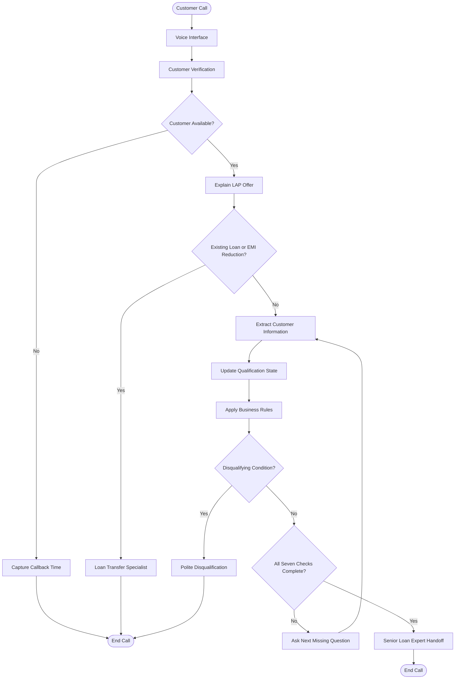

# 🤖 AI Voice Agent for Home Credit
### Intelligent Voice Automation for Loan Against Property (LAP) Preliminary Qualification

<p align="center">
  <strong>Conversational AI • Prompt Engineering • NLP • Rule-Based Decision Making</strong>
</p>

<p align="center">
  
  
  
</p>

---

## 💡 Overview

**What if a loan qualification conversation could be as natural as speaking to a real person?**

This project presents the design of an **AI-powered voice agent for Home Credit** that automates preliminary customer qualification for a Loan Against Property (LAP) offer of up to **₹75 lakh**.

The agent is designed to communicate with existing customers, verify their identity, understand their requirements, collect essential eligibility information, apply predefined business rules, and route suitable leads to a senior loan expert.

Instead of following a rigid question-and-answer script, the proposed system is designed to understand natural speech, remember previously provided information, handle interruptions, and ask only the next unanswered question.

> 🎯 **Core objective:** Build a reliable, conversational, and rule-driven voice agent that streamlines preliminary loan qualification without making final lending decisions.

---

## 🚀 Key Features

| Feature | Description |
|---|---|
| 🗣️ Conversational AI | Supports natural customer responses instead of rigid, fixed-format answers. |
| 🔐 Customer Verification | Confirms the intended customer before discussing offer details. |
| 🧠 Context Awareness | Captures multiple relevant facts from a single response. |
| 📋 Seven-Point Qualification | Collects and validates the required preliminary eligibility information. |
| ⚙️ Business Rule Engine | Applies predefined qualification and disqualification rules. |
| 🔄 Correction Handling | Updates stored information when a customer corrects an earlier answer. |
| 📞 Callback Management | Captures a convenient callback time when the customer is unavailable. |
| 🔀 Intelligent Routing | Directs existing-property-loan and EMI-reduction cases to a specialist workflow. |
| 📚 RAG-Ready Context | Uses approved product information and avoids inventing unsupported details. |
| 👨‍💼 Human Handoff | Routes qualified preliminary leads to a senior loan expert. |

---

## 🏗️ System Architecture

The proposed system combines conversational understanding, qualification state management, business rules, and outcome routing.



### 🔍 How It Works

1. **Verify:** Confirm that the intended customer is speaking.
2. **Understand:** Explain the LAP offer and identify the customer's requirement.
3. **Extract:** Identify relevant information from the customer's response.
4. **Remember:** Update the internal qualification state and preserve corrections.
5. **Validate:** Apply the defined business rules to the captured information.
6. **Route:** Handle callback requests, disqualification, specialist cases, or missing information.
7. **Handoff:** Send eligible preliminary leads to a senior loan expert once all required checks are complete.

---

## 📋 The Seven-Point Eligibility Checklist

The agent collects the following information for fresh-loan requests.

| No. | Eligibility Parameter | Qualification Rule |
|---:|---|---|
| 1 | Property Type | Residential, commercial, and industrial properties may proceed. Agricultural property is disqualified. |
| 2 | Ownership Status | Sole and joint ownership are accepted. |
| 3 | Original Property Documents | Original documents must be available for verification. |
| 4 | Desired Loan Amount | Amounts up to ₹75 lakh may proceed. Higher requests trigger an alternative offer. |
| 5 | Occupation & Income Mode | Salaried and self-employed customers may proceed with bank-mode income. Cash-mode income is disqualified. |
| 6 | Estimated Market Value | Capture the customer's approximate property value. No minimum value threshold is assumed. |
| 7 | Desired Loan Tenure | Tenure must be between 3 and 15 years, inclusive. |

### ⚖️ Business Rules

The qualification engine is designed to apply these rules consistently:

- **Agricultural property:** Stop the fresh-loan qualification flow.
- **Unavailable original documents:** Disqualify the application from this preliminary offer.
- **Cash-mode income:** Disqualify under the specified rules.
- **Tenure outside 3–15 years:** Disqualify.
- **Loan request above ₹75 lakh:** Offer to continue with ₹75 lakh rather than rejecting automatically.
- **Joint ownership:** Accept and continue.
- **Existing property loan or EMI-reduction request:** Route to a loan-transfer specialist.
- **Unknown property value:** Record an estimate if provided; do not invent a minimum threshold.
- **Missing information:** Ask for clarification or the earliest unanswered checklist item.

**Important:** This is preliminary qualification logic, not a final credit decision or loan approval system.

---

## 🧠 Conversation Intelligence

One of the key design principles is to process every customer response before deciding what to ask next.

**Extract → Validate → Update → Respond**

For example, if a customer says:

> "My property is a commercial shop, jointly owned with my brother, and its market value is around ₹1 crore."

The agent should capture three facts immediately:

- Property type: Commercial
- Ownership: Joint
- Market value: Approximately ₹1 crore

It should then ask only for the earliest unanswered eligibility item instead of repeating questions that have already been answered.

### Edge Cases Considered

- Customers provide answers out of order.
- Customers change or correct previous answers.
- Customers ask about interest rates or other product details.
- Customers interrupt the conversation.
- Customers give ambiguous answers about document availability.
- Customers request callbacks or indicate that they are busy.
- Customers disclose an existing loan or EMI-reduction requirement.
- Customers request an amount greater than the stated offer limit.

The design prioritizes clear business rules and appropriate routing over simply completing a fixed script.

---

## 🛠️ Technology & Design Concepts

The project is centered on AI conversation design and prompt engineering. The final technology stack depends on the selected implementation platform.

| Component | Purpose |
|---|---|
| Voice-Agent Platform | Voice interaction, call control, and conversation execution |
| Large Language Model | Natural-language understanding and response generation |
| Prompt Engineering | Defines role, conversation flow, rules, and response behavior |
| Conversation State | Tracks eligibility fields and previously supplied answers |
| Business Rule Logic | Controls qualification, disqualification, and routing |
| Retrieval-Augmented Generation (RAG) | Supplies approved product information when available |
| Call Logs & Transcripts | Support testing, auditing, and evaluation |

Potential voice-agent platforms include Retell AI, Bolna, or comparable services.

*The actual platform, model, integrations, and versions should be documented after implementation. They are not claimed as deployed components in this design report.*

---

## 🧪 Testing Strategy

The proposed testing plan covers successful qualification, disqualification, specialist routing, and conversational edge cases.

| Test Case | Expected Outcome |
|---|---|
| Eligible customer | Complete all seven checks and initiate senior-expert handoff. |
| Agricultural property | Disqualify immediately. |
| Cash-mode income | Disqualify under the specified rules. |
| Original documents unavailable | Disqualify immediately. |
| Tenure of 2 years | Disqualify. |
| Tenure of 20 years | Disqualify. |
| Loan request of ₹90 lakh | Offer the ₹75 lakh alternative. |
| Joint property ownership | Continue qualification. |
| Existing loan against the property | Route to specialist workflow. |
| Existing EMI-reduction request | Route to specialist workflow. |
| Multiple facts in one response | Capture all clear facts and avoid repeated questions. |
| Customer is busy | Record a convenient callback time and end the call. |
| Customer corrects an answer | Use the latest clear answer. |
| Customer asks for an interest rate | Avoid inventing a rate and defer to an authorized expert. |
| Ambiguous document status | Clarify before making a decision. |

### 📊 Evaluation Metrics

After executing the test scenarios, evaluate the system using:

- **Checklist completeness:** Percentage of required fields captured correctly.
- **Rule accuracy:** Percentage of test decisions matching expected outcomes.
- **Routing accuracy:** Correct handling of callbacks, transfers, disqualifications, and handoffs.
- **Repeated-question rate:** Frequency of unnecessarily repeated questions.
- **Unsupported-claim count:** Number of product claims not supported by approved information.
- **Interruption recovery:** Ability to resume from the correct missing checklist item.

Actual test results, recordings, and performance metrics must be added after execution.

---

## 📁 Project Structure

A suggested repository organization is:

```text
ai-voice-agent-home-credit/
│
├── README.md
├── docs/
│   ├── project-report.pdf
│   ├── system-architecture.png
│   ├── conversation-flow.png
│   └── test-cases.md
│
├── prompts/
│   └── lap-qualification-agent.md
│
├── tests/
│   └── test-scenarios.md
│
└── results/
    └── evaluation-template.md
```

*This is a suggested structure, not a claim that all these files have already been created.*

---

## 🔮 Future Enhancements

- Integrate a production-ready voice-agent platform.
- Add speech recognition and text-to-speech configuration.
- Connect approved customer and product information sources.
- Implement structured state storage and automated rule validation.
- Add secure lead-routing and CRM integration.
- Evaluate multilingual conversations and different accents.
- Introduce automated regression testing for prompt changes.
- Build an evaluation dashboard for qualification and routing metrics.
- Add human-review workflows and appropriate audit logging.

---

## 🎓 Project Information

**Project Title:** AI Voice Agent for Home Credit — Preliminary Qualification for a Loan Against Property Offer

**Submitted by:** Bhavana U Naidu

**Department:** Computer Science / Artificial Intelligence & Machine Learning

**Location:** Bengaluru, India

**Year:** 2026

**Project Type:** AI Voice Automation & Prompt Engineering

---

## ⚠️ Disclaimer

This repository documents a proposed AI voice-agent design for preliminary LAP qualification based on specified business requirements. It is not an official Home Credit product, lending policy, or loan approval service.

The agent must not guarantee approval, invent interest rates or fees, or replace authorized lending professionals. Any actual deployment requires appropriate authorization, validated business rules, privacy safeguards, and compliance review.

---

## 🌟 Project Vision

**Making financial conversations smarter, more consistent, and more human-centered through conversational AI.**

This project explores how carefully designed prompts, explicit decision rules, and conversation-state management can work together to automate preliminary customer interactions while preserving clear boundaries for human decision-making.

---

<p align="center">
  <strong>Built with curiosity, designed with logic, and powered by conversational AI. 🤖</strong>
</p>
