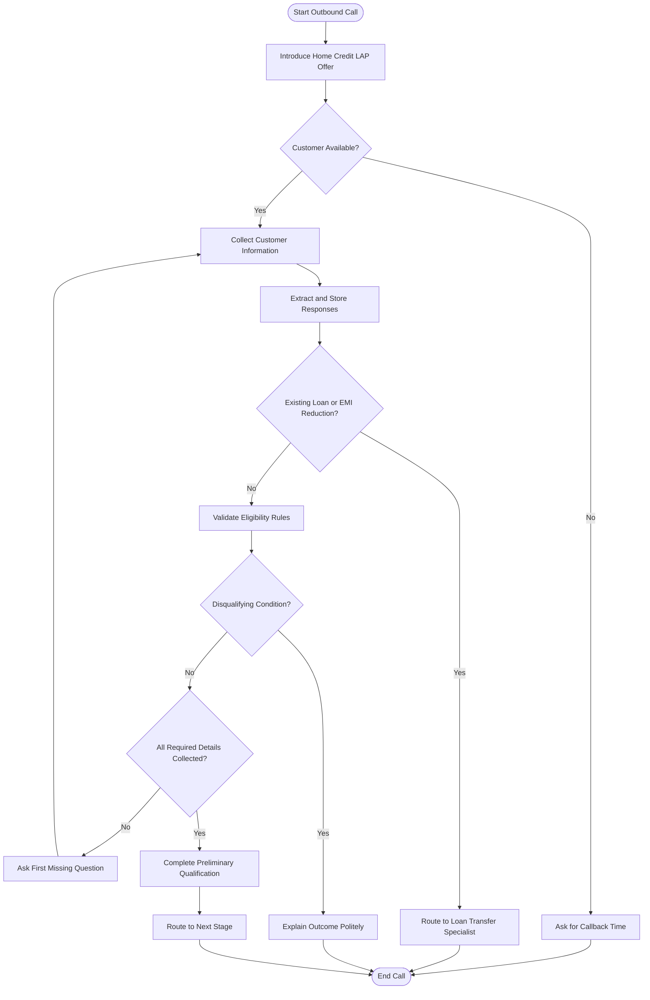

# 🤖 SalesAgents AI — Home Credit Loan Against Property (LAP) Voice Agent

<p align="center">

**An AI-Powered Voice Agent for Intelligent Customer Outreach and LAP Eligibility Qualification**

Automating customer conversations through structured, context-aware, and rule-based AI voice interactions.

</p>

---

## 📑 Table of Contents

| S. No. | Section | Description |
|:---:|---|---|
| 1 | [About the Project](#-1-about-the-project) | Project overview, problem statement, objectives, and scope |
| 2 | [Features](#-2-features) | Core capabilities and eligibility decision logic |
| 3 | [Technologies Used](#-3-technologies-used) | Tools, frameworks, and technologies |
| 4 | [Prerequisites](#-4-prerequisites) | Required software, dependencies, and credentials |
| 5 | [Installation](#-5-installation) | Repository setup and installation instructions |
| 6 | [Usage](#-6-usage) | Running the agent and understanding the conversation flow |
| 7 | [Project Structure](#-7-project-structure) | Organization of project files and folders |
| 8 | [Configuration](#-8-configuration) | Prompt variables, business rules, and runtime settings |
| 9 | [Screenshots and Sample Conversations](#-9-screenshots-and-sample-conversations) | Demonstrations, transcripts, and recordings |
| 10 | [Testing](#-10-testing) | Test scenarios and expected outcomes |
| 11 | [Contributing](#-11-contributing) | Guidelines for improving the project |
| 12 | [License](#-12-license) | Licensing and usage information |

---

## 🎯 1. About the Project

### 📌 Project Overview

The **Home Credit Loan Against Property (LAP) AI Voice Agent** is an AI-powered conversational system designed to make outbound calls to existing Home Credit customers and assess their preliminary eligibility for a Loan Against Property.

The agent introduces the potential loan offer, collects customer information through a natural conversation, evaluates the information against predefined business rules, and determines whether the customer can proceed to the next stage of the qualification process.

The system is designed to behave like a professional voice-based customer service representative. It follows a structured conversation flow while remembering information already provided by the customer, handling interruptions, responding to relevant questions, and avoiding unnecessary repetition.

The potential loan amount covered by this assignment is **up to ₹75,00,000 (₹75 lakh)**, subject to preliminary eligibility checks and subsequent verification.

### 💡 Problem Statement

Traditional outbound loan qualification calls can require significant manual effort. Agents must ask multiple questions, record customer responses, validate eligibility criteria, and determine the appropriate next step.

This process can result in:

- Repeated questions when information is provided out of order.
- Inconsistent application of eligibility criteria.
- Incorrect handling of customer interruptions.
- Missed or incomplete customer information.
- Unclear outcomes for customers who do not meet the requirements.
- Delays in routing qualified customers to the next stage.

The proposed AI voice agent addresses these challenges through a structured, context-aware, and rule-driven conversational workflow.

### 🎯 Project Objectives

1. Automate outbound customer conversations regarding LAP.
2. Collect all required eligibility information through natural dialogue.
3. Remember details supplied earlier, even when the customer answers questions out of order.
4. Apply predefined qualification and disqualification rules consistently.
5. Handle loan amounts exceeding the stated limit without automatically rejecting the customer.
6. Identify existing property loans and EMI-reduction requests that require specialist assistance.
7. Handle busy customers by requesting a convenient callback time.
8. Respond to customer questions using available and verified information.
9. Minimize repeated questions and maintain conversational continuity.
10. Generate a clear preliminary qualification outcome.

### 🏦 Business Use Case

| Parameter | Description |
|---|---|
| Business | Home Credit |
| Product | Loan Against Property (LAP) |
| Agent Type | AI-powered outbound voice agent |
| Target Audience | Existing Home Credit customers |
| Maximum Loan Amount | Up to ₹75 lakh |
| Primary Objective | Preliminary eligibility qualification |
| Interaction Style | Conversational, professional, and customer-friendly |
| Final Outcome | Preliminary qualification, disqualification, specialist routing, or callback |
| Approval Status | Final loan approval is subject to further assessment and verification |

### 🔄 High-Level Workflow



---

## ✨ 2. Features

### 2.1 AI-Powered Outbound Calling

The agent initiates a conversation with existing customers and introduces the Loan Against Property offering in a professional and customer-friendly manner.

It should clearly communicate the purpose of the call without implying that a loan is already approved.

### 2.2 Sequential Eligibility Assessment

The agent collects the information required for preliminary qualification using a predefined checklist.

| No. | Eligibility Parameter | Accepted Condition | Disqualification or Alternative Action |
|:---:|---|---|---|
| 1 | Property Type | Residential, Commercial, or Industrial | Agricultural property results in disqualification |
| 2 | Property Ownership | Sole or Joint ownership | Neither ownership type can be assumed; clarify if unclear |
| 3 | Original Property Documents | Original documents are available | Unavailable original documents result in disqualification |
| 4 | Loan Amount | Up to ₹75 lakh | If above ₹75 lakh, explain the limit and ask whether the customer wants to continue with ₹75 lakh |
| 5 | Occupation and Income Mode | Salaried or Self-employed; income received through a bank | Cash income results in disqualification |
| 6 | Property Market Value | Customer provides the property's market value | Record the value; do not invent a minimum threshold |
| 7 | Loan Tenure | 3 to 15 years, inclusive | Tenure below 3 years or above 15 years results in disqualification |

**Important:** The property market value is collected as an eligibility input. No minimum market value threshold is specified in this assignment, so the agent must not invent one.

### 2.3 Smart Conversation Memory

The agent remembers information provided earlier in the conversation.

For example, if the customer mentions that the property is commercial before being asked about the property type, the agent stores that information and does not ask the same question again.

### 2.4 Out-of-Order Response Handling

The agent does not require customers to answer questions in a fixed order.

It extracts all relevant details from each response, updates the conversation state, and asks only for the next missing item.

### 2.5 Intelligent Loan Amount Handling

If a customer requests an amount exceeding ₹75 lakh, the agent should explain the maximum amount covered by the offer and ask whether the customer wishes to continue with ₹75 lakh.

- If the customer agrees, record ₹75 lakh as the amount to proceed with.
- If the customer declines, politely end the standard qualification flow.
- If the customer is unsure, clarify the choice without assuming consent.

The agent must not automatically disqualify the customer solely because the initial requested amount exceeds ₹75 lakh.

### 2.6 Specialist Routing

Customers who indicate that they already have a loan against the property or want to reduce their existing EMI should be routed to the appropriate loan-transfer specialist.

The agent should stop the standard LAP qualification process after identifying this requirement.

### 2.7 Callback Management

If a customer is busy, the agent should:

1. Acknowledge that the customer is unavailable.
2. Ask for a suitable callback time.
3. Record the requested callback time.
4. End the current call politely.

### 2.8 Context-Aware Responses

The agent can respond to relevant customer questions using the available knowledge base or retrieval-augmented generation (RAG) context.

If the answer is unavailable, the agent should acknowledge the limitation rather than invent information.

### 2.9 Interruption Handling

When a customer interrupts or changes the topic, the agent should respond briefly and return to the first unanswered eligibility question.

### 2.10 Clear Qualification Outcomes

The agent should maintain a clear distinction between:

- Preliminary qualification.
- Disqualification under a stated rule.
- Specialist routing.
- Callback scheduling.
- Incomplete assessment.
- Final loan approval, which is outside the agent's preliminary qualification decision.

---

## 🛠️ 3. Technologies Used

The following table lists technologies that may be used to implement this project. Replace the examples with the tools actually used in your repository.

| Technology | Purpose |
|---|---|
| Large Language Model (LLM) | Understand customer responses and generate conversational replies |
| System Prompt Engineering | Define agent identity, behavior, business rules, and conversation flow |
| Python or JavaScript/TypeScript | Implement supporting application logic, if applicable |
| Speech-to-Text (STT) | Convert customer speech into text |
| Text-to-Speech (TTS) | Convert agent responses into spoken audio |
| Voice Agent Platform | Manage calls and real-time voice interactions |
| REST APIs | Connect the agent with external services, if required |
| RAG / Knowledge Base | Retrieve approved information to answer customer questions |
| JSON | Represent structured customer data and eligibility state |
| Git | Track source-code changes |
| GitHub | Host the project repository and documentation |

### Technology Architecture

```text
Customer
   |
   v
Outbound Calling Platform
   |
   v
Speech Recognition (STT)
   |
   v
LLM + System Prompt
   |
   +---- Conversation State
   |
   +---- Eligibility Rules
   |
   +---- Knowledge Base / RAG
   |
   v
Response Generation
   |
   v
Text-to-Speech (TTS)
   |
   v
Customer
```

**Note:** If your assignment was implemented entirely using a voice-agent platform's prompt editor, do not claim that you developed separate Python code, APIs, STT, or TTS components unless you actually did so.

---

## 📋 4. Prerequisites

Before running or evaluating the project, ensure that the following requirements are met.

### Software Requirements

- A computer with internet access.
- A modern web browser.
- Access to the selected AI or voice-agent platform.
- Git and GitHub, if using a repository-based workflow.
- Python or Node.js, only if required by your implementation.
- An audio player for reviewing test recordings.
- A text editor or IDE, such as Visual Studio Code.

### Account and Access Requirements

- Access to the selected LLM or voice-agent platform.
- API credentials, if the implementation uses external APIs.
- A configured voice and language.
- Access to approved business information for the LAP product.
- Test audio files or simulated customer conversations.

### Business Rule Requirements

The agent must have access to the following predefined rules:

- Eligible property types.
- Accepted ownership types.
- Original property document availability requirements.
- Maximum loan amount of ₹75 lakh.
- Accepted occupation and income modes.
- Property market value collection requirement.
- Loan tenure range of 3–15 years.
- Existing-loan and EMI-reduction specialist routing rules.

### Security Requirements

- Store API keys and credentials securely.
- Do not commit secrets to GitHub.
- Use synthetic customer data for public demonstrations.
- Ensure that actual customer recordings are shared only when authorized and appropriately protected.

---

## 📦 5. Installation

Installation depends on the platform used to build the voice agent. The following steps cover a typical GitHub-based project.

### Step 1: Clone the Repository

Replace the example URL with your actual repository URL.

```bash
git clone https://github.com/YOUR-USERNAME/YOUR-REPOSITORY.git
```

### Step 2: Navigate to the Project Folder

```bash
cd YOUR-REPOSITORY
```

### Step 3: Review the Repository

```bash
git status
```

Review the files and identify the system prompt, configuration files, test cases, and documentation.

### Step 4: Install Dependencies

For a Python implementation that includes a `requirements.txt` file:

```bash
python -m venv .venv
```

Activate the environment on Windows:

```bash
.venv\Scripts\activate
```

Activate the environment on macOS or Linux:

```bash
source .venv/bin/activate
```

Install dependencies:

```bash
pip install -r requirements.txt
```

For a Node.js implementation with a `package.json` file:

```bash
npm install
```

**Important:** Run only the installation commands relevant to your actual project. If the project is configured entirely through an online voice-agent platform, local dependency installation may not be required.

### Step 5: Configure Credentials

Create a local environment file if required by your implementation.

Example `.env`:

```dotenv
LLM_API_KEY=your_api_key_here
VOICE_PLATFORM_API_KEY=your_voice_platform_api_key_here
```

Do not use real credentials in this example or commit the actual `.env` file to GitHub.

### Step 6: Configure the Agent

Import or paste the system prompt into the selected voice-agent platform. Configure the model, voice, language, business context, and any required integrations.

### Step 7: Run or Deploy

Use the platform's test interface or the actual application entry point defined in your project.

For example, only if your Python application contains `main.py`:

```bash
python main.py
```

For example, only if your Node.js project defines a start script:

```bash
npm start
```

### Step 8: Validate the Setup

Before using the agent, test a simulated conversation to confirm that it:

- Introduces the LAP offer correctly.
- Captures customer responses.
- Remembers information provided out of order.
- Applies the eligibility rules correctly.
- Handles customer questions and interruptions.
- Produces the correct preliminary outcome.

---

## ▶️ 6. Usage

### 6.1 Starting the Agent

1. Open the configured voice-agent platform or application.
2. Load the LAP qualification system prompt.
3. Provide the required runtime variables.
4. Confirm the configured language and voice.
5. Start a simulated or authorized test call.
6. Review the conversation transcript and qualification result.

### 6.2 Conversation Workflow

The agent should follow this general sequence:

| Step | Action | Expected Behavior |
|:---:|---|---|
| 1 | Introduction | Identify the company and explain the purpose of the call |
| 2 | Availability check | If busy, ask for a callback time and end the call |
| 3 | Context extraction | Identify facts already provided by the customer |
| 4 | Specialist check | Route existing-loan or EMI-reduction requests appropriately |
| 5 | Eligibility collection | Ask for missing information in the prescribed order |
| 6 | Rule validation | Apply the stated eligibility and disqualification rules |
| 7 | Missing information check | Ask only for unanswered questions |
| 8 | Outcome | Communicate preliminary qualification or the appropriate alternative |
| 9 | Closure | End politely and preserve the correct call outcome |

### 6.3 Sample Conversation: Eligible Customer

**AI Agent:** Hello, may I speak with the customer? I am calling on behalf of Home Credit regarding a potential Loan Against Property offer. Is this a convenient time to speak?

**Customer:** Yes, I can talk.

**AI Agent:** Thank you. I will ask a few brief questions to understand whether you may qualify for the offer. What type of property would you like to use?

**Customer:** It is a commercial property, jointly owned by me and my brother.

**AI Agent:** Thank you. I have recorded that it is a commercial property with joint ownership. Are the original property documents available?

**Customer:** Yes, we have them.

**AI Agent:** Great. What loan amount are you looking for?

**Customer:** ₹40 lakh.

**AI Agent:** Thank you. Are you salaried or self-employed, and is your income received through a bank or in cash?

**Customer:** I am self-employed, and my income is received through the bank.

**AI Agent:** Understood. What is the approximate market value of your property?

**Customer:** Around ₹90 lakh.

**AI Agent:** Thank you. What loan tenure would you prefer, between 3 and 15 years?

**Customer:** Ten years.

**AI Agent:** Thank you for sharing those details. Based on the information provided, you meet the stated preliminary qualification criteria. This is not a final loan approval; further assessment and verification will be required.

### 6.4 Sample Conversation: Loan Amount Above the Limit

**Customer:** I need ₹90 lakh.

**AI Agent:** The maximum loan amount covered by this offer is ₹75 lakh. Would you like to continue the preliminary assessment for ₹75 lakh?

**Customer:** Yes, that is fine.

**AI Agent:** Thank you. I will record ₹75 lakh as the amount to proceed with and continue with the remaining eligibility questions.

### 6.5 Sample Conversation: Agricultural Property

**Customer:** The property is agricultural land.

**AI Agent:** Thank you for clarifying. Under the eligibility criteria for this offer, agricultural property does not qualify. I appreciate your time and will conclude the assessment here.

### 6.6 Sample Conversation: Cash Income

**Customer:** I am self-employed, but I receive my income in cash.

**AI Agent:** Thank you for sharing that information. Under the eligibility criteria for this offer, income must be received through a bank. Based on this requirement, I am unable to proceed with the standard qualification process.

### 6.7 Sample Conversation: Existing Property Loan

**Customer:** I already have a loan against this property, and I want to reduce my EMI.

**AI Agent:** I understand. Since you are looking to reduce the EMI on an existing property loan, I will direct your request to the appropriate loan-transfer specialist for further assistance.

### 6.8 Sample Conversation: Customer Is Busy

**Customer:** I am busy right now.

**AI Agent:** Certainly. What would be a convenient time for us to call you back?

**Customer:** Tomorrow at 11 AM.

**AI Agent:** Thank you. I have recorded your requested callback time as tomorrow at 11 AM. Have a good day.

**Implementation note:** The callback must be scheduled only if the system supports scheduling and the required date and time are resolved correctly. Otherwise, record the requested callback time for follow-up.

---

## 🗂️ 7. Project Structure

The following is a suggested repository structure. Adapt it to match your actual files.

```text
salesagents-ai-lap-voice-agent/
│
├── README.md
│
├── prompts/
│   └── lap_system_prompt.md
│
├── config/
│   └── eligibility_rules.json
│
├── src/
│   ├── main.py
│   ├── conversation_manager.py
│   ├── eligibility_checker.py
│   └── voice_agent.py
│
├── tests/
│   ├── test_eligibility.md
│   ├── test_conversations.md
│   └── test_results.md
│
├── recordings/
│   └── README.md
│
├── transcripts/
│   └── README.md
│
├── docs/
│   ├── architecture.md
│   └── conversation_flow.md
│
├── .env.example
├── .gitignore
└── requirements.txt
```

### File and Folder Descriptions

| File or Folder | Purpose |
|---|---|
| `README.md` | Main project documentation |
| `prompts/` | Contains the system prompt and conversation instructions |
| `config/` | Contains eligibility rules and other configurable settings |
| `src/` | Contains application logic, if developed separately |
| `tests/` | Contains test cases and test results |
| `recordings/` | Documents or stores authorized test audio recordings |
| `transcripts/` | Stores approved test conversation transcripts |
| `docs/` | Contains architecture diagrams and supporting documentation |
| `.env.example` | Shows the required environment variable names without exposing secrets |
| `.gitignore` | Prevents sensitive or unnecessary files from being committed |
| `requirements.txt` | Lists Python dependencies, if applicable |

**For a prompt-only assignment:** A simpler structure may be more accurate:

```text
salesagents-ai-lap-voice-agent/
├── README.md
├── system_prompt.md
├── test_scenarios.md
├── test_results.md
├── transcripts/
└── recordings/
```

Do not create empty folders merely to make the repository look larger.

---

## ⚙️ 8. Configuration

### 8.1 Runtime Variables

The assignment provides the following variables for contextualizing the agent.

| Variable | Purpose | Example |
|---|---|---|
| `company_name` | Company represented by the agent | Home Credit |
| `customer_name` | Customer's name, if available | Customer name from approved test data |
| `agent_name` | Configured agent name | Agent name supplied at runtime |
| `agent_gender` | Configured agent gender for appropriate self-reference or voice settings | Value supplied at runtime |
| `current_date` | Current date for contextual responses | Runtime-provided date |
| `current_day` | Current day | Runtime-provided day |
| `current_time` | Current time | Runtime-provided time |
| `additional_context_from_rag` | Approved retrieved information | Product FAQ or approved business information |
| `language_to_speak` | Language used for the conversation | Configured language |
| `conversation_history` | Previous conversation messages | Stored dialogue |
| `customer_utterance` | Latest customer response | Latest transcribed customer message |

The agent should use the provided values rather than hardcoding customer details, agent identity, dates, or language.

### 8.2 Eligibility Rules

The following is an illustrative JSON configuration for implementations that support external rule configuration.

```json
{
  "product": "Loan Against Property",
  "company": "Home Credit",
  "maximum_loan_amount_inr": 7500000,
  "accepted_property_types": [
    "residential",
    "commercial",
    "industrial"
  ],
  "disallowed_property_types": [
    "agricultural"
  ],
  "accepted_ownership_types": [
    "sole",
    "joint"
  ],
  "original_property_documents_required": true,
  "accepted_occupations": [
    "salaried",
    "self-employed"
  ],
  "accepted_income_modes": [
    "bank"
  ],
  "minimum_tenure_years": 3,
  "maximum_tenure_years": 15,
  "property_market_value_minimum": null
}
```

**Important:** This example is a proposed configuration, not proof that the project already uses JSON. A `null` market-value threshold means no minimum threshold has been specified in the assignment; it does not mean the property has no value requirement under any future lender policy.

### 8.3 Conversation State Management

The agent should maintain a structured state for each conversation.

Example:

```json
{
  "property_type": null,
  "ownership_type": null,
  "original_documents_available": null,
  "requested_loan_amount": null,
  "occupation": null,
  "income_mode": null,
  "property_market_value": null,
  "loan_tenure_years": null,
  "existing_property_loan": null,
  "emi_reduction_requested": null,
  "callback_time": null,
  "qualification_status": "in_progress",
  "missing_fields": []
}
```

### 8.4 Recommended Processing Logic

For every new customer response, the agent should:

1. **Extract** all relevant facts from the latest utterance.
2. **Validate** the facts against the business rules.
3. **Update** the conversation state.
4. **Check** whether specialist routing or immediate disqualification applies.
5. **Identify** the first missing eligibility item.
6. **Ask** the next relevant question without repeating previously answered questions.
7. **Complete** the assessment only when all required fields are available and no disqualifying condition remains.

### 8.5 Configuration Principles

- Never assume missing customer information.
- Do not treat an ambiguous response as confirmed information.
- Resolve contradictory answers by politely asking for clarification.
- Do not invent interest rates, fees, approval guarantees, or minimum property-value thresholds.
- Do not treat a preliminary qualification result as final approval.
- If a required variable or knowledge-base answer is unavailable, follow a safe fallback rather than fabricating information.
- Apply specialist routing before continuing the standard qualification checklist when the customer requests an existing-loan transfer or EMI reduction.

---

## 🖼️ 9. Screenshots and Sample Conversations

This section should contain genuine screenshots and supporting evidence from your implementation.

### 9.1 Recommended Screenshots

| Screenshot | What It Should Demonstrate |
|---|---|
| Agent Configuration | The configured AI voice agent or platform |
| System Prompt | The main instructions governing the agent |
| Conversation Test | A simulated customer interaction |
| Eligibility Validation | A test showing the rules being applied |
| Successful Qualification | A completed preliminary qualification scenario |
| Disqualification Scenario | A test involving an agricultural property or cash income |
| Specialist Handoff | A test involving an existing property loan or EMI reduction |
| Test Results | Evidence of the scenarios executed and their outcomes |

### 9.2 Add Screenshots to GitHub

Save the screenshots in an `assets/` folder or another folder used by your repository.

Example:

```text
assets/
├── agent-configuration.png
├── conversation-test.png
├── eligibility-test.png
└── test-results.png
```

Then embed them in your README using Markdown:

```markdown
### Agent Configuration


### Conversation Test


### Eligibility Validation


```

Replace these example paths with your actual image paths. Do not leave broken image links in the final repository.

### 9.3 Audio Recordings and Transcripts

The assignment may require test audio recordings, transcripts, call logs, and public recording links. Include them only when they have been generated and can be shared appropriately.

A useful transcript format is:

| Field | Details |
|---|---|
| Test ID | T01 |
| Scenario | Eligible customer |
| Customer Input | Responses provided during the simulated call |
| Agent Response | Corresponding agent replies |
| Expected Outcome | Preliminary qualification |
| Actual Outcome | Result observed during testing |
| Status | Pass / Fail / Not Run |

For privacy and security, use synthetic customer information in public examples unless disclosure has been explicitly authorized.

---

## 🧪 10. Testing

Testing verifies that the AI voice agent follows the required business rules, maintains conversation state, and responds appropriately to different customer situations.

### 10.1 Test Scenarios

| Test ID | Scenario | Expected Result |
|---|---|---|
| T01 | All eligibility criteria are satisfied | Complete preliminary qualification |
| T02 | Agricultural property | Disqualify under the stated property rule |
| T03 | Residential property | Accept property type |
| T04 | Commercial property | Accept property type |
| T05 | Industrial property | Accept property type |
| T06 | Sole ownership | Accept ownership type |
| T07 | Joint ownership | Accept ownership type |
| T08 | Original documents unavailable | Disqualify |
| T09 | Requested amount is ₹40 lakh | Continue with the requested amount |
| T10 | Requested amount exceeds ₹75 lakh and customer agrees to ₹75 lakh | Continue using ₹75 lakh |
| T11 | Requested amount exceeds ₹75 lakh and customer declines the limit | End the standard qualification flow |
| T12 | Salaried customer with bank-received income | Accept occupation and income mode |
| T13 | Self-employed customer with bank-received income | Accept occupation and income mode |
| T14 | Customer receives income in cash | Disqualify |
| T15 | Customer provides property market value | Record the value without inventing a minimum threshold |
| T16 | Tenure is below 3 years | Disqualify |
| T17 | Tenure is exactly 3 years | Accept tenure |
| T18 | Tenure is between 3 and 15 years | Accept tenure |
| T19 | Tenure is exactly 15 years | Accept tenure |
| T20 | Tenure exceeds 15 years | Disqualify |
| T21 | Existing loan against the property | Route to loan-transfer specialist |
| T22 | Customer wants EMI reduction | Route to loan-transfer specialist |
| T23 | Customer is busy | Ask for callback time and end the current call |
| T24 | Customer provides information out of order | Store the information and avoid repeating questions |
| T25 | Customer provides multiple answers in one response | Extract and store all relevant facts |
| T26 | Customer gives contradictory information | Ask for clarification |
| T27 | Customer gives an ambiguous answer | Clarify before marking the field complete |
| T28 | Customer asks about interest rates not present in approved context | Avoid inventing rates; use a safe response |
| T29 | Customer interrupts the checklist | Respond briefly and resume the first missing item |
| T30 | Required information is incomplete | Continue asking for missing details |
| T31 | Customer asks an unrelated question | Respond briefly when possible and return to the qualification flow |
| T32 | All required information is collected and rules pass | Communicate preliminary qualification, not final approval |

### 10.2 Boundary Testing

Boundary tests are especially important because several rules use numerical limits.

| Parameter | Test Input | Expected Result |
|---|---:|---|
| Maximum loan amount | ₹75,00,000 | Within the stated limit |
| Maximum loan amount | ₹75,00,001 | Explain the limit and ask whether the customer wants to proceed with ₹75 lakh |
| Minimum tenure | 2 years | Disqualify |
| Minimum tenure | 3 years | Accept |
| Maximum tenure | 15 years | Accept |
| Maximum tenure | 16 years | Disqualify |

### 10.3 Test Results Template

Record the actual outcome only after running each test.

| Test ID | Expected Result | Actual Result | Status | Remarks |
|---|---|---|---|---|
| T01 | Preliminary qualification | Pending | Not Run | To be tested |
| T02 | Disqualification | Pending | Not Run | To be tested |
| T08 | Disqualification | Pending | Not Run | To be tested |
| T10 | Continue with ₹75 lakh | Pending | Not Run | To be tested |
| T14 | Disqualification | Pending | Not Run | To be tested |
| T16 | Disqualification | Pending | Not Run | To be tested |
| T21 | Specialist routing | Pending | Not Run | To be tested |
| T23 | Callback handling | Pending | Not Run | To be tested |
| T24 | Store out-of-order responses | Pending | Not Run | To be tested |
| T28 | Safe response without fabricated rates | Pending | Not Run | To be tested |

### 10.4 Testing Checklist

- [ ] Agent introduces the product correctly.
- [ ] All seven eligibility checklist items are covered, including both occupation and income mode.
- [ ] Information provided out of order is remembered.
- [ ] Previously answered questions are not repeated unnecessarily.
- [ ] Agricultural property is handled correctly.
- [ ] Original document availability is validated.
- [ ] Loan amounts above ₹75 lakh trigger the appropriate clarification.
- [ ] Cash income is handled according to the rules.
- [ ] Tenure boundaries are tested.
- [ ] Existing-loan and EMI-reduction requests trigger specialist routing.
- [ ] Busy customers are offered a callback.
- [ ] Ambiguous and contradictory answers are clarified.
- [ ] Unsupported claims and invented interest rates are avoided.
- [ ] Final messaging distinguishes preliminary qualification from loan approval.

---

## 🤝 11. Contributing

Contributions and suggestions can help improve the agent's conversational quality, business-rule accuracy, and testing coverage.

### How to Contribute

1. Review the existing project documentation.
2. Identify a specific issue or improvement.
3. Create a branch for the proposed change.
4. Make the change while preserving the stated business rules.
5. Test the updated prompt or application.
6. Document the test results.
7. Submit a pull request describing the changes.

Example commands:

```bash
git checkout -b feature/improve-conversation-flow
git add .
git commit -m "Improve LAP conversation flow"
git push origin feature/improve-conversation-flow
```

### Contribution Guidelines

- Keep eligibility rules consistent with the assignment.
- Do not invent additional qualification criteria.
- Preserve customer privacy.
- Avoid committing API keys, secrets, or confidential recordings.
- Add tests for changes to qualification logic.
- Document any new configuration requirements.
- Clearly distinguish proposed enhancements from implemented features.

---

## 📄 12. License

This project was created for an AI Voice Agent design and qualification assignment.

Unless a specific license has been selected and included in the repository, the project should not be described as having an open-source license.

If you intend to publish the project publicly, choose an appropriate license and add a `LICENSE` file after confirming that you have permission to share all included code, prompts, recordings, and other materials.

Example wording if the repository is an assignment submission:

> This repository is intended for educational and evaluation purposes. All third-party tools, models, trademarks, and services remain the property of their respective owners. The presence of Home Credit branding or product references does not imply official endorsement or affiliation.

---

## 🚀 Future Enhancements

The following features could be considered in future versions, depending on platform capabilities and business requirements:

- Multilingual customer conversations.
- Improved speech recognition for regional accents.
- CRM integration for customer details and call outcomes.
- Automated callback scheduling.
- Structured analytics and qualification dashboards.
- Enhanced call summaries and reporting.
- Improved handling of ambiguous or contradictory responses.
- Integration with an approved knowledge base.
- Automated regression testing for prompt updates.
- Human-agent handoff with relevant conversation context.

These are proposed enhancements and should not be presented as implemented unless they have been built and tested.

---

## 🏁 Conclusion

The **SalesAgents AI — Home Credit Loan Against Property Voice Agent** demonstrates how conversational AI and structured prompt engineering can support preliminary customer qualification through outbound voice interactions.

By combining context-aware dialogue, conversation-state management, predefined eligibility rules, and appropriate routing, the agent aims to deliver a consistent and customer-friendly qualification experience.

The primary focus is not merely to ask questions, but to understand customer responses, remember previously provided information, apply the rules accurately, and determine the appropriate next step without making unsupported claims.

**Built with a focus on structured conversations, reliable qualification logic, and responsible AI-driven customer engagement.**

