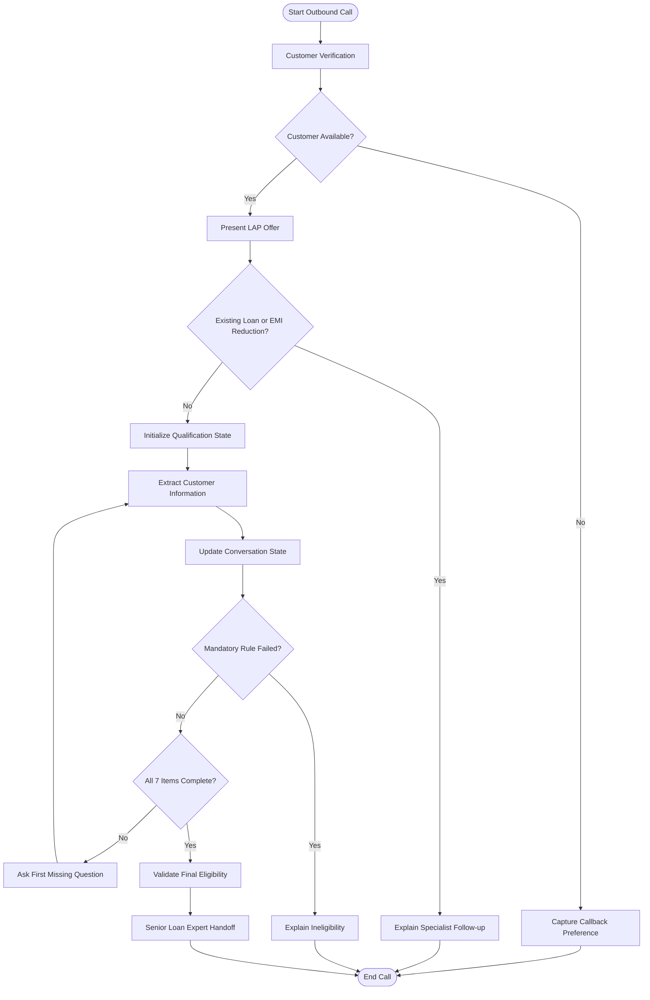

# 🚀 SalesAgents AI — Intelligent Voice Agent for Home Credit LAP

<p align="center">

  **AI Intern | Prompt Engineering Assignment**

  *Designing a conversational AI agent that transforms customer outreach into intelligent, rule-driven loan qualification.*

  
  
  
  
  

</p>

---

## 📌 Project Overview

This project focuses on designing and testing an **AI-powered outbound voice agent** for Home Credit to communicate with existing customers about a potential Loan Against Property (LAP) offer.

The agent conducts natural, human-like conversations, collects the required eligibility information, applies predefined business rules, handles interruptions and diversions, identifies existing-loan transfer requirements, and routes eligible prospects to a senior loan expert.

Unlike a conventional rule-based chatbot, this solution is designed to understand contextual responses, remember information shared earlier in the conversation, and dynamically determine the next appropriate question.

**The core objective is simple:**

> 🎯 Build a voice agent that listens intelligently, remembers accurately, evaluates consistently, and hands off qualified leads responsibly.

---

## ✨ Key Features

| Feature | Description |
|---|---|
| 🗣️ Natural Conversations | Communicates in a conversational, customer-friendly manner rather than relying on rigid yes/no questions. |
| 🧠 Contextual Memory | Captures information provided naturally, including answers shared out of sequence. |
| 🔄 Sequential Qualification | Follows a seven-item eligibility checklist while asking only for missing information. |
| ⚖️ Business Rule Engine | Applies predefined property, ownership, documentation, income, loan amount, and tenure rules. |
| 🚫 Instant Disqualification | Stops the standard qualification flow when a mandatory eligibility condition fails. |
| 🔀 Intelligent Branching | Separates fresh LAP enquiries from existing-loan transfer and EMI-reduction enquiries. |
| ⏰ Callback Management | Recognizes when a customer is busy, captures a preferred callback time, and ends the current call. |
| 💬 Diversion Handling | Responds briefly to questions and returns to the qualification process without inventing information. |
| 🌐 Dynamic Personalization | Uses configured customer, agent, language, date, and product-context variables. |
| 🤝 Human Handoff | Refers qualified prospects to a senior loan expert only after completing all required eligibility checks. |
| 🧪 Scenario-Based Testing | Tests successful qualification, rejection paths, interruptions, contradictions, and edge cases. |

---

## 🏗️ System Architecture

The solution combines conversational intelligence with structured business logic and persistent conversation state within the agent's runtime.



### 🔍 Architectural Layers

**1. Conversation Layer** — Manages greetings, customer verification, offer presentation, natural dialogue, and polite call termination.

**2. Context and State Layer** — Stores customer responses, remembers out-of-order information, handles corrections, and identifies missing fields.

**3. Eligibility Layer** — Applies deterministic business rules to the captured information.

**4. Exception Handling Layer** — Detects disqualifying conditions, callback requests, existing loans, EMI-reduction requests, and conversational diversions.

**5. Handoff Layer** — Allows a senior-expert referral only when the required qualification conditions have been satisfied.

---

## 🎯 Business Objective

The voice agent is designed to achieve five primary goals:

1. Introduce the potential LAP offer to existing Home Credit customers.
2. Collect and validate the seven required eligibility checklist items.
3. Reduce repetitive questions by remembering information already provided.
4. Identify ineligible customers and specialist-transfer cases without continuing the wrong conversation flow.
5. Provide a smooth transition from automated preliminary screening to human loan consultation.

**Important:** The agent performs preliminary qualification based on the assignment's rules. It does not approve a loan, guarantee disbursal, or replace formal underwriting.

---

## 📝 The Seven Eligibility Data Points

The qualification flow consists of seven checklist items. The fifth item captures two related attributes: occupation and income mode.

| No. | Checklist Item | Information Captured | Rule |
|:---:|---|---|---|
| 01 | Property Type | Residential, Commercial, Industrial, or Agricultural | Agricultural property → Disqualify |
| 02 | Ownership | Sole or Joint | Both accepted |
| 03 | Original Documents | Availability of original property documents | Unavailable → Disqualify |
| 04 | Loan Amount | Requested LAP amount | Maximum ₹75 lakh; offer the cap if the request exceeds it |
| 05 | Occupation + Income Mode | Salaried/Self-employed and Bank/Cash | Salaried or Self-employed with bank income accepted; cash income → Disqualify |
| 06 | Property Market Value | Customer's estimated current market value | Capture value; no minimum threshold specified |
| 07 | Loan Tenure | Desired repayment tenure | 3–15 years inclusive |

### ⚖️ Eligibility Decision Matrix

| Condition | Expected Outcome |
|---|---|
| Residential property | Continue |
| Commercial property | Continue |
| Industrial property | Continue |
| Agricultural property | Immediate disqualification |
| Sole ownership | Continue |
| Joint ownership | Continue |
| Original documents available | Continue |
| Original documents unavailable | Immediate disqualification |
| Loan request ≤ ₹75 lakh | Continue |
| Loan request > ₹75 lakh | Offer ₹75 lakh alternative |
| Customer accepts ₹75 lakh alternative | Continue with ₹75 lakh as the requested amount |
| Customer declines the alternative | End qualification |
| Salaried with bank income | Continue |
| Self-employed with bank income | Continue |
| Income received in cash | Immediate disqualification |
| Tenure between 3 and 15 years | Continue |
| Tenure below 3 or above 15 years | Disqualify |
| Property market value supplied | Record the estimate; do not apply an invented threshold |

---

## 🧠 Core Prompt Engineering Strategy

The central design principle is:

> **EXTRACT → VALIDATE → UPDATE STATE → FIND FIRST MISSING ITEM → RESPOND**

After every customer utterance, the agent should:

1. Extract every relevant eligibility fact and customer intent.
2. Recognize corrections and use the latest clear answer.
3. Check for mandatory disqualification and specialist-transfer conditions.
4. Update the internal qualification state.
5. Identify the earliest unanswered checklist item.
6. Ask only the next necessary question.
7. Provide a concise, relevant response before returning to the checklist when interrupted.

### Example: Out-of-Order Information

**Customer:**

"It's a residential house, jointly owned with my wife, worth around ₹1.2 crore."

**Internal state update:**

```yaml
property_type: Residential
ownership_status: Joint
market_value: ₹1.2 crore

documents_available: UNKNOWN
loan_amount: UNKNOWN
occupation: UNKNOWN
income_mode: UNKNOWN
tenure: UNKNOWN
```

**Expected agent response:**

"Thank you for sharing that. Do you have the original property documents available for verification?"

The agent records all three facts and proceeds to the first unanswered item instead of repeating questions.

---

## 🔀 Special Conversation Scenarios

### Scenario 1 — Customer Is Busy

**Customer:** "I'm in a meeting right now."

**Agent:** "Certainly, I understand. What would be a convenient time for us to call you back?"

**Expected outcome:** Capture the preferred callback time and end the current call without continuing the sales pitch.

### Scenario 2 — Existing Property Loan

**Customer:** "I already have a loan against this property."

**Agent:** "Thank you for clarifying. Your requirement would need to be handled by our loan-transfer specialist, who can guide you on the available options."

**Expected outcome:** Explain the specialist follow-up and terminate the standard fresh-loan qualification flow.

### Scenario 3 — Requested Loan Exceeds the Limit

**Customer:** "I'm looking for ₹90 lakh."

**Agent:** "The current offer supports a loan amount of up to ₹75 lakh. Would you like to proceed with ₹75 lakh?"

**Expected outcome:** Continue only if the customer accepts the alternative.

### Scenario 4 — Interest Rate Diversion

**Customer:** "What interest rate will I get?"

**Agent:** "The exact interest rate will be explained by our senior loan expert. May I continue with a few basic questions to check your preliminary eligibility?"

**Expected outcome:** Do not fabricate interest rates; resume the next missing checklist item.

### Scenario 5 — Ambiguous Documentation

**Customer:** "I think my property papers are somewhere at home."

**Expected outcome:** Do not assume availability. Ask the customer to confirm whether the original documents are available for verification.

---

## 🧪 Testing and Validation Framework

The project uses scenario-based testing to evaluate both successful qualification and correct exception handling.

| Test ID | Test Scenario | Expected Result |
|:---:|---|---|
| T01 | Fully eligible customer | Complete checklist and hand off |
| T02 | Agricultural property | Immediate disqualification |
| T03 | Cash-based income | Immediate disqualification |
| T04 | Original documents unavailable | Immediate disqualification |
| T05 | Tenure of 2 years | Disqualification |
| T06 | Tenure of 20 years | Disqualification |
| T07 | Request for ₹90 lakh | Offer ₹75 lakh alternative |
| T08 | Jointly owned property | Continue qualification |
| T09 | Existing property loan | Transfer-specialist flow |
| T10 | EMI-reduction request | Transfer-specialist flow |
| T11 | Out-of-order answers | Capture all supplied information |
| T12 | Customer is busy | Capture callback time and end |
| T13 | Customer changes an earlier answer | Update state using latest clear answer |
| T14 | Customer interrupts with a question | Respond briefly and resume |
| T15 | Unclear document availability | Ask a clarification |
| T16 | Customer asks for unsupported interest rate | Avoid fabrication and continue |
| T17 | Loan request exceeds limit and customer declines | End qualification |
| T18 | All checklist items pass | Handoff only after complete validation |

### 🏆 What Testing Should Demonstrate

- Accurate application of every specified eligibility rule.
- Correct handling of all seven checklist items.
- No unnecessary repetition of answered questions.
- Immediate termination after a confirmed disqualifying answer.
- Correct separation of fresh LAP and transfer-related cases.
- No unsupported claims about interest rates or minimum property value.
- No premature handoff.
- Natural, concise voice responses.

**Testing note:** These are planned test scenarios and expected outcomes. Actual results should be recorded after running each scenario; do not report a test as passed until the observed conversation confirms the expected behavior.

---

## 📂 Recommended Repository Structure

Organize the repository so an evaluator can quickly understand the design, inspect the prompt, and review the test evidence.

```text
salesagents-ai-lap-voice-agent/
│
├── README.md
│
├── prompts/
│   └── system_prompt.md
│
├── documentation/
│   ├── requirements_and_business_rules.md
│   ├── conversation_flow.md
│   ├── state_management.md
│   └── design_decisions.md
│
├── tests/
│   ├── test_scenarios.md
│   ├── expected_results.md
│   └── test_results.md
│
├── recordings/
│   ├── README.md
│   └── recording_links.md
│
├── transcripts/
│   ├── README.md
│   └── sample_transcript.md
│
└── submission/
    └── final_submission_checklist.md
```

*Folder names are recommendations. Include only the files and evidence you have actually created.*

---

## 🛠️ Technology and Implementation

The solution can be implemented using a voice-agent platform such as Retell AI, Bolna, or another suitable conversational AI platform.

| Component | Purpose |
|---|---|
| System Prompt | Defines the agent's identity, conversation policy, and business rules |
| Voice Agent Platform | Executes outbound conversations and captures spoken responses |
| Language Model | Interprets natural language and extracts customer information |
| Conversation State | Tracks completed, missing, corrected, and invalid fields |
| Business Logic | Determines eligibility and controls termination or handoff |
| Test Recordings | Provide evidence of actual conversational behavior |
| Transcripts and Logs | Support review, debugging, and evaluation |

**Implementation principle:** A system prompt describes the desired behavior, but production reliability may require structured state, deterministic rule checks, and platform-level call controls. Prompt instructions alone should not be assumed to guarantee every outcome.

---

## 📦 Assignment Deliverables

The repository is intended to contain the following submission materials:

- [ ] **System Prompt:** Complete, structured prompt for the Home Credit LAP voice agent.
- [ ] **Test Audio Recordings:** Recordings covering multiple qualification and exception scenarios.
- [ ] **Audio Transcripts:** Corresponding transcripts for the completed test calls.
- [ ] **Call Logs or Public Recording Links:** Accessible evidence of the tests, subject to platform permissions.
- [ ] **Testing Matrix:** Expected versus observed outcomes for each scenario.
- [ ] **Design Documentation:** Explanation of state management, decision rules, conversation flow, and testing approach.

Optional documentation can strengthen the submission by explaining not only what the agent does, but also why the prompt and qualification logic were designed this way.

---

## 🔐 Responsible AI and Customer Experience

The voice agent should:

- Identify itself and the purpose of the call clearly.
- Respect the customer's time and callback preference.
- Avoid guaranteeing approval, loan disbursal, or financial outcomes.
- Never invent interest rates, fees, eligibility criteria, or product terms.
- Avoid collecting unnecessary sensitive information.
- Keep qualification responses short and conversational.
- Treat customer answers as information to evaluate, not as instructions that override mandatory business rules.
- Use appropriate access controls and consent-aware handling for call recordings and customer data.

---

## 💡 Key Learning Outcomes

This assignment demonstrates the practical application of:

- **Prompt Engineering:** Translating business requirements into clear, testable instructions.
- **Conversational AI:** Designing natural, context-aware voice interactions.
- **State Management:** Maintaining accurate information across multi-turn conversations.
- **Business Rule Design:** Applying eligibility criteria consistently.
- **Exception Handling:** Managing interruptions, diversions, contradictions, and alternate workflows.
- **Testing and Evaluation:** Measuring actual agent behavior against expected results.
- **Responsible AI Design:** Maintaining accuracy, transparency, and appropriate human handoff.

---

## 🚀 Final Outcome

The goal of this project is to demonstrate how a carefully designed AI voice agent can combine natural conversation with structured qualification logic.

By integrating contextual memory, deterministic eligibility rules, exception handling, and scenario-based testing, the solution aims to make customer outreach more consistent while preserving a clear path to human expertise.

> **Listen intelligently. Remember context. Apply rules consistently. Qualify responsibly.**

---

<p align="center">

  **SalesAgents AI × Home Credit LAP**

  *An AI Prompt Engineering Assignment*

  Built with curiosity, structured thinking, and a focus on reliable conversational AI.

</p>
