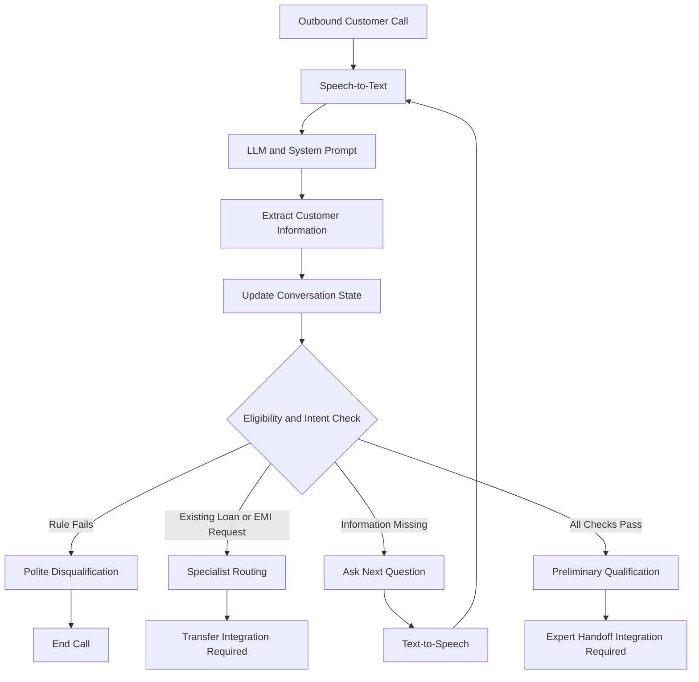

🏦 AI Voice Agent for Home Credit — Loan Against Property (LAP)

An Intelligent Voice-Based Customer Qualification System


An AI-powered outbound calling agent designed to contact existing Home Credit customers, introduce a Loan Against Property (LAP) offer of up to ₹75 lakh, conduct preliminary eligibility screening, and identify qualified customers for further assistance from a senior loan expert.

The system combines conversational AI, structured decision-making, conversational state management, and rule-based eligibility checks to deliver a consistent and customer-friendly calling experience.

📌 Table of Contents

Project Overview

Problem Statement

Objectives

Key Features

System Architecture

Conversation Workflow

Eligibility Rules

Technology Stack

Project Structure

Implementation and Configuration

Testing and Results

Responsible AI and Safety

Limitations

Future Enhancements

Conclusion

🚀 Project Overview

Traditional loan qualification calls require human agents to ask repetitive questions, collect customer information, and identify potential leads. This process can be time-consuming and inconsistent when performed at scale.

This project introduces an AI voice agent built using Retell AI to automate the initial qualification stage for Home Credit's Loan Against Property offering.

The agent initiates an outbound conversation, verifies the intended customer, checks their availability, explains the loan offer, and collects the required eligibility information through natural conversation.

It maintains conversational context, recognizes answers provided out of order, accepts corrections, and immediately stops qualification when a mandatory eligibility condition fails.

Customers who satisfy all configured criteria are identified as qualified leads for a senior loan expert. Final loan approval remains subject to the lender's verification process.

Project Highlights

Offer amount: Up to ₹75 lakh

Interaction: Automated outbound voice calls

Platform: Retell AI

Languages: English, with Hindi testing

Qualification method: Conversational AI with predefined business rules

Primary outcome: Preliminary qualification and specialist handoff

🎯 Problem Statement

Manual loan qualification involves repetitive conversations, inconsistent information collection, and time-consuming lead screening.

The objective is to develop an AI voice agent that can:

Contact existing customers and verify their identity.

Present the LAP offer professionally without pressuring the customer.

Recognize existing loan-transfer and EMI-reduction enquiries.

Collect and validate all mandatory eligibility details.

Remember information shared at any point in the conversation.

Handle interruptions, corrections, unclear answers, and customer objections.

Disqualify customers when mandatory criteria are not met.

Identify qualified leads for further evaluation by a human loan expert.

🎯 Objectives

Develop a reusable system prompt for an outbound AI voice agent.

Design a structured conversation flow with clear decision-making rules.

Implement conversational memory to prevent repeated questions.

Apply consistent eligibility validation.

Prevent unsupported claims about interest rates, charges, or approval.

Test the agent against normal, edge, and failure scenarios.

Maintain transcripts and audio recordings as testing evidence.

Identify implementation gaps and opportunities for future integration.

✨ Key Features

Feature

Description

Intelligent greeting

Greets the customer using the configured customer name and time of day.

Identity verification

Confirms that the intended customer is speaking before disclosing the offer.

Availability detection

Handles busy customers and records requested callback details.

Natural conversation

Uses short acknowledgements and one primary question per turn.

Eligibility screening

Validates property type, ownership, documents, amount, income, value, and tenure.

Context awareness

Captures information even when the customer answers questions out of order.

Correction handling

Updates previously recorded answers when the customer provides a clear correction.

Early disqualification

Stops qualification as soon as a mandatory rule fails.

Existing-loan routing

Recognizes relevant existing-loan and EMI-reduction requests.

Knowledge-grounded responses

Avoids inventing unsupported product information.

Post-call extraction

Structures customer responses and call outcomes for review.

🏗️ System Architecture

The agent follows a conversational processing loop that converts customer speech into a response and determines the next action.

flowchart TD
    A[Outbound Customer Call] --> B[Speech-to-Text]
    B --> C[System Prompt and Conversation History]
    C --> D[Extract Customer Information]
    D --> E[Update Conversational State]
    E --> F{Eligibility and Intent Check}

    F -->|Mandatory Rule Fails| G[Polite Disqualification]
    F -->|Existing Loan or EMI Request| H[Specialist Routing Intent]
    F -->|Required Information Missing| I[Ask Next Relevant Question]
    F -->|All Checks Passed| J[Qualified Lead and Handoff Message]

    I --> K[Text-to-Speech]
    K --> B

    G --> L[End Call]
    H --> M[Transfer Action Required]
    J --> N[Expert Handoff Action Required]

Important implementation note: The prototype's conversational logic supports routing and handoff messages, but live specialist transfer and CRM-based callback execution still require integration.

Core Processing Components

Speech recognition: Converts customer speech into text.

Language model: Interprets the customer's response using the system prompt.

State management: Tracks known answers, missing information, corrections, and decision flags.

Eligibility engine: Applies the configured business rules.

Speech generation: Converts the response into natural spoken output.

Call actions: Ends the call or initiates integrated routing actions when available.

🔄 Conversation Workflow

The conversation follows four primary stages.

Stage 1: Greeting and Verification

Greet the customer professionally.

Confirm the intended person's identity.

Do not disclose loan details to an unverified person.

If the customer is busy, ask for a convenient callback time and end the current call.

Stage 2: Offer Presentation

Introduce the Loan Against Property offer of up to ₹75 lakh.

Explain that the call is for preliminary eligibility screening.

Ask the customer's permission to continue.

Stage 3: Intent Detection

Identify existing loans against the relevant property.

Recognize requests for existing-loan transfers or EMI reduction.

Stop the new-loan qualification flow when such an intent is detected.

Direct the customer toward the appropriate specialist workflow.

Stage 4: Eligibility Screening

Collect the seven required eligibility categories.

Record answers provided out of order.

Clarify uncertain or contradictory information.

Stop immediately if a mandatory eligibility rule fails.

Identify the customer as preliminarily qualified only after all required checks pass.

✅ Eligibility Rules

The following rules are the project's configured preliminary screening criteria, not a representation of independently verified current Home Credit policy.

No.

Eligibility parameter

Configured rule

Decision

1

Property type

Residential, commercial, or industrial

Agricultural property is disqualified.

2

Ownership

Sole or joint

Both are accepted.

3

Original documents

Available for verification

Clearly unavailable documents result in disqualification.

4

Requested loan amount

Greater than ₹0 and up to ₹75 lakh

Explain the cap and obtain consent to continue at ₹75 lakh if the request exceeds it.

5

Occupation and income

Salaried or self-employed, with applicable income received through a bank

Cash-only income is disqualified under the configured rule.

6

Property market value

Customer's estimated property value is recorded

No minimum value is defined by this prototype.

7

Repayment tenure

3–15 years, inclusive

Tenures outside the range are disqualified unless the customer accepts an eligible tenure.

Qualification Decision Logic

START
  |
  v
Verify Customer Identity
  |
  v
Is the Customer Available?
  |---- No ----> Record Callback Request -> End Call
  |
 Yes
  |
  v
Present LAP Offer and Obtain Consent
  |
  v
Check for Existing-Loan / EMI-Reduction Intent
  |---- Yes ----> Specialist Routing Workflow
  |
  No
  |
  v
Collect and Validate Required Information
  |
  v
Does Any Mandatory Rule Fail?
  |---- Yes ----> Disqualify Politely -> End Call
  |
  No
  |
  v
Are All Required Answers Clear and Complete?
  |---- No ----> Ask for Missing or Unclear Information
  |
  Yes
  |
  v
Mark as Preliminarily Qualified
  |
  v
Senior Expert Handoff

Key principle: Qualification is based on explicit customer responses. Missing information, unclear answers, and unresolved contradictions must never be treated as successful eligibility checks.

🛠️ Technology Stack

Technology / Component

Purpose

Retell AI

Voice-agent configuration and telephony platform

Large Language Model

Conversational understanding and response generation

Speech-to-Text

Customer speech transcription

Text-to-Speech

Natural spoken responses

System Prompt

Defines role, workflow, validation rules, and conversational behaviour

Knowledge Base

Provides approved product information

Dynamic Variables

Personalizes the agent and supplies call-specific context

Post-Call Extraction

Structures customer details and call outcomes

Important Agent Configuration

Setting

Configured value

Agent type

Single-prompt agent

Speaking behaviour

AI speaks first

Voice

Professional Indian-English female voice

Languages

English; Hindi tested separately

Interruption sensitivity

0.6

Response wait time

750 ms, dynamic

Reminder

After 10 seconds, up to 2 times

Denoising

Enabled

Transcription

Optimized for accuracy

Silence termination

25 seconds

Maximum call duration

10 minutes

End Call function

Configured

Post-call extraction

12 fields

Dynamic Variables

The prompt uses runtime placeholders such as:

{{company_name}}

{{customer_name}}

{{agent_name}}

{{agent_gender}}

{{current_date}}

{{current_day}}

{{current_time}}

{{language_to_speak}}

{{additional_context_from_rag}}

{{conversation_history}}

{{customer_utterance}}

These values support personalization, language consistency, callback context, and conversation continuity.

📁 Project Structure

A recommended repository layout is:

home-credit-lap-voice-agent/
│
├── README.md
│
├── docs/
│   ├── project-documentation.md
│   ├── system-architecture.md
│   ├── eligibility-rules.md
│   └── implementation-guide.md
│
├── prompts/
│   └── lap_system_prompt.md
│
├── tests/
│   ├── test-scenarios.md
│   ├── test-results.md
│   └── transcripts/
│
├── evidence/
│   ├── audio/
│   └── screenshots/
│
└── LICENSE

Note: This is a recommended structure for organizing the project. Create only the folders and files that you actually use. Do not commit customer-identifiable data, confidential call recordings, API keys, or access tokens.

⚙️ Implementation and Configuration

Step 1: Create the Voice Agent

Create a single-prompt agent in Retell AI and configure it to initiate the conversation.

Step 2: Add the System Prompt

Include the agent's role, greeting rules, identity verification, eligibility criteria, state-management instructions, disqualification logic, and closing messages.

Step 3: Configure Dynamic Variables

Set the company name, customer name, agent identity, language, date, day, and time.

Step 4: Configure Voice Settings

Apply the voice, transcription, interruption, response timing, noise reduction, and call-duration settings documented in the project.

Step 5: Configure Actions and Extraction

Configure the End Call action and post-call extraction. Integrate actual specialist transfers and callback scheduling separately if the platform workflow supports them.

Step 6: Run Test Scenarios

Execute simulated conversations covering eligible customers, disqualifications, corrections, interruptions, unclear responses, and specialist-routing intents.

Step 7: Record Evidence

Save relevant transcripts, test outcomes, audio recordings where available, and screenshots of the agent configuration.

🧪 Testing and Results

The test plan covers normal, edge, and failure scenarios to verify whether the agent follows the configured conversation and eligibility rules.

Test

Scenario

Expected behaviour

Reported outcome

1

Fully eligible customer

Complete checks and proceed to handoff

Pass

2

Agricultural property

Immediate disqualification

Pass

3

Cash-based income

Immediate disqualification

Pass

4

Original documents unavailable

Immediate disqualification

Pass

5

Tenure of 2 years

Disqualification

Pass

6

Tenure of 20 years

Disqualification

Pass

7

Loan request of ₹90 lakh

Offer ₹75 lakh maximum and seek consent

Pass

8

Joint ownership

Continue qualification

Pass

9

Existing loan against the property

Route to specialist workflow

Pass

10

EMI-reduction request

Route to relevant specialist workflow

Pass

11

Answers provided out of order

Store answers and ask the next missing question

Pass

12

Busy customer

Record callback preference and end call

Pass

13

Residential property corrected to agricultural

Apply the latest clear answer

Pass

14

Multiple answers in one sentence

Capture facts without unnecessary repetition

Pass

15

Customer interrupts to ask about documents

Answer briefly and resume appropriately

Pass

16

Vague answer about document availability

Ask a clarifying question

Pending

Reported Test Summary

15 scenarios reported as completed.

15 completed scenarios reported as passing.

1 additional scenario remains pending.

Audio recordings were available for 11 of the 15 completed scenarios.

Four completed scenarios had transcript-only evidence at the time of reporting.

Observations and Known Issues

Speech recognition occasionally misheard customer responses. The agent sometimes asked for clarification instead of assuming an answer.

The interruption scenario needs further refinement because the agent repeated the question after answering the customer's side question.

The EMI-reduction scenario should not assume that the existing loan is secured against the same property unless the customer confirms this or an approved workflow establishes it.

The specialist transfer and expert callback are not yet connected to live execution actions.

The pending document-clarification scenario must be run and documented before the test suite can be considered complete.

The reported outcomes reflect the project's testing notes. Final submission evidence should include the corresponding transcripts or recordings, and each result should be reproducible.

🔐 Responsible AI and Safety

The system incorporates safeguards to support consistent and responsible customer interactions.

Privacy protection: Do not disclose the offer or account-related information before verifying the intended customer.

No fabricated information: Do not invent rates, charges, product policies, or processing timelines.

No approval guarantees: Preliminary qualification must not be represented as final credit approval.

Customer consent: Respect refusals and requests to end the call.

Clear uncertainty handling: Ask for clarification when eligibility information is unclear.

Consistent decision-making: Apply the same configured rules to equivalent customer responses.

Controlled handoff: Recommend specialist handoff only after all required qualification checks pass.

Data protection: Store recordings and transcripts only in authorized locations with appropriate access controls.

⚠️ Limitations

Conversational state is primarily maintained through prompt instructions and conversation history rather than a dedicated structured state database.

The live specialist-transfer and callback-scheduling workflows are not yet integrated.

Speech recognition may misinterpret accents, names, loan amounts, or tenure values.

Product-related responses depend on the approved knowledge base.

Some test scenarios have transcript-only evidence rather than audio recordings.

The document-clarification scenario remains pending.

The agent performs preliminary screening only; it does not conduct final credit underwriting or approve loans.

🔮 Future Enhancements

1. Structured State Management

Store each eligibility answer, validation result, and decision flag in structured variables or a database.

2. CRM Integration

Automatically save qualified leads, customer preferences, and callback requests in a CRM system.

3. Live Specialist Transfer

Connect the routing logic to an actual specialist queue and verify that transfers complete successfully.

4. Multilingual Conversations

Expand language support with automatic language detection and testing across additional Indian languages.

5. Automated Regression Testing

Run all test scenarios after every prompt change to detect regressions in qualification logic.

6. Analytics Dashboard

Track qualification rates, disqualification reasons, call duration, customer objections, and transfer outcomes.

7. Improved Speech Recognition

Add confirmation steps for critical values such as loan amounts, property classifications, and repayment tenure.

8. Better Observability

Maintain structured logs, test evidence, and action-execution status to improve debugging and auditability.

🏁 Conclusion

The Home Credit LAP AI Voice Agent demonstrates how conversational AI can automate the first stage of loan qualification through structured prompting, eligibility validation, contextual memory, and customer-friendly dialogue.

The project emphasizes consistent rule application, recognition of customer intent, handling of out-of-order responses, and safe treatment of incomplete or contradictory information.

The current prototype establishes a foundation for automated preliminary screening. With structured state management, CRM integration, live specialist routing, and complete regression-test evidence, the system can be developed further toward a reliable production implementation.

👩‍💻 Project Information

Project: AI Voice Agent for Home Credit Loan Against Property (LAP)
Platform: Retell AI
Category: Conversational AI / Voice Automation / FinTech
Primary Goal: Automated preliminary customer qualification


# 🏦 AI Voice Agent for Home Credit — Loan Against Property (LAP)

### ***An Intelligent Voice-Based Customer Qualification System***

<p align="center">
  
  
  
  
</p>

---

## 🌟 ***Project Overview***

This project presents an **AI-powered outbound voice agent** designed to contact existing Home Credit customers, introduce a Loan Against Property (LAP) offer of up to **₹75 lakh**, and perform preliminary eligibility screening through natural conversation.

The agent verifies customer identity, understands customer intent, collects eligibility information, handles interruptions and corrections, and identifies customers who meet the configured qualification criteria.

> **🎯 Main Goal:** Automate preliminary loan qualification while providing a professional, consistent, and customer-friendly calling experience.

**Key Highlights:**
- 🤖 Automated outbound AI calling
- 🏠 Loan Against Property qualification
- 🧠 Context-aware conversational memory
- ✅ Rule-based eligibility validation
- 🔄 Existing-loan and EMI-reduction intent detection
- 📞 Preliminary qualification and specialist handoff workflow

---

## 📌 ***Table of Contents***

1. [Problem Statement](#-problem-statement)
2. [Project Objectives](#-project-objectives)
3. [Key Features](#-key-features)
4. [System Architecture](#-system-architecture)
5. [Conversation Workflow](#-conversation-workflow)
6. [Eligibility Criteria](#-eligibility-criteria)
7. [Technology Stack](#️-technology-stack)
8. [Project Structure](#-project-structure)
9. [Testing and Results](#-testing-and-results)
10. [Responsible AI and Safety](#-responsible-ai-and-safety)
11. [Limitations](#️-limitations)
12. [Future Enhancements](#-future-enhancements)
13. [Conclusion](#-conclusion)

---

## 🎯 ***Problem Statement***

Traditional loan qualification calls require human agents to ask repetitive questions, record customer information, and determine whether customers meet preliminary eligibility requirements.

This manual process can be time-consuming and inconsistent.

The objective of this project is to develop an AI voice agent that can:

- Verify customer identity before discussing the offer.
- Present the LAP offer professionally.
- Collect and validate mandatory eligibility information.
- Remember answers provided in any order.
- Handle customer interruptions and corrections.
- Disqualify customers immediately when mandatory rules fail.
- Identify existing-loan and EMI-reduction enquiries.
- Identify eligible leads for further evaluation by a senior loan expert.

---

## 🎯 ***Project Objectives***

| No. | Objective | Expected Benefit |
|---:|---|---|
| 1 | Develop a structured system prompt | Consistent conversations |
| 2 | Design a defined conversation workflow | Clear decision-making |
| 3 | Maintain conversational context | Avoid repeated questions |
| 4 | Apply predefined eligibility rules | Consistent qualification |
| 5 | Prevent fabricated product information | Safer customer interactions |
| 6 | Test normal, edge, and failure scenarios | Improved reliability |
| 7 | Record transcripts and call evidence | Verifiable results |

---

## ✨ ***Key Features***

| Feature | Description |
|---|---|
| 🤖 Intelligent Greeting | Greets customers using configured dynamic variables. |
| 🔐 Identity Verification | Avoids disclosing the offer to an unverified person. |
| ⏰ Callback Handling | Records a convenient callback time when the customer is busy. |
| 🧠 Conversational Memory | Remembers information provided out of order. |
| ✏️ Correction Handling | Uses the latest clear customer response. |
| 🚫 Early Disqualification | Stops qualification when a mandatory rule fails. |
| 💰 Loan Amount Validation | Explains the maximum offer of ₹75 lakh. |
| 🔄 Intent Recognition | Detects relevant existing-loan and EMI-reduction requests. |
| 📋 Post-Call Extraction | Structures customer details and call outcomes. |
| 🛡️ Responsible Responses | Avoids unsupported rates, fees, and approval promises. |

---

## 🏗️ ***System Architecture***

The system follows a conversational processing loop in which the customer's speech is interpreted, relevant information is extracted, eligibility rules are evaluated, and the next response or action is selected.



### ***Processing Components***

- **Speech-to-Text:** Converts customer speech into text.
- **Large Language Model:** Understands the customer's responses and generates suitable replies.
- **Conversation State:** Tracks eligibility answers, corrections, and missing information.
- **Eligibility Logic:** Applies the configured business rules.
- **Text-to-Speech:** Converts generated responses into spoken audio.
- **Call Actions:** Ends calls and supports routing workflows when the required integrations are configured.

> **⚠️ Implementation Note:** The current prototype supports the conversational routing logic, but actual specialist transfers and CRM-based callback execution still require integration.

---

## 🔄 ***Conversation Workflow***

### **Stage 1 — Greeting and Verification**
- Greet the customer.
- Verify the intended customer's identity.
- Check whether the customer is available.
- Record a callback preference if the customer is busy.

### **Stage 2 — Offer Presentation**
- Introduce the LAP offer of up to **₹75 lakh**.
- Explain that the conversation is for preliminary qualification.
- Obtain permission before continuing.

### **Stage 3 — Intent Detection**
- Detect existing loans against the relevant property.
- Recognize requests related to existing-loan transfers or EMI reduction.
- Stop the new-loan qualification flow when applicable.
- Route the customer to the relevant specialist workflow.

### **Stage 4 — Eligibility Screening**
- Collect all seven eligibility categories.
- Record answers provided out of order.
- Clarify incomplete or contradictory responses.
- Disqualify immediately when a mandatory rule fails.
- Identify qualified leads only after every required check passes.

---

## 🏠 ***Eligibility Criteria***

The following are the **configured screening rules for this prototype**, not independently verified current Home Credit lending policy.

| No. | Eligibility Parameter | Accepted Criteria | Failure Action |
|---:|---|---|---|
| 1 | Property Type | Residential, commercial, industrial | Agricultural property: disqualify |
| 2 | Ownership | Sole or joint | Both accepted |
| 3 | Original Documents | Available for verification | Clearly unavailable: disqualify |
| 4 | Loan Amount | Greater than ₹0, up to ₹75 lakh | Explain cap and obtain consent to proceed at ₹75 lakh |
| 5 | Occupation and Income | Salaried or self-employed; applicable income received through a bank | Cash-only income: disqualify |
| 6 | Market Value | Customer's estimated property value | Record estimate; no minimum configured |
| 7 | Repayment Tenure | 3–15 years, inclusive | Outside range: disqualify unless an eligible tenure is accepted |

### ***Final Qualification Rules***

A customer can be marked **PRELIMINARILY QUALIFIED** only when:

- Identity verification is complete.
- The customer agrees to continue.
- No applicable specialist-routing condition has been triggered.
- All seven eligibility categories have clear answers.
- Every applicable eligibility rule passes.
- No unresolved contradiction affects the decision.
- No disqualification flag is active.

> **Important:** Preliminary qualification does not guarantee loan approval or disbursement.

---

## 🛠️ ***Technology Stack***

| Technology | Purpose |
|---|---|
| **Retell AI** | Voice-agent configuration and telephony |
| **Large Language Model** | Conversational understanding and response generation |
| **Speech-to-Text** | Customer speech transcription |
| **Text-to-Speech** | Natural spoken responses |
| **System Prompt** | Conversation rules and eligibility logic |
| **Knowledge Base** | Approved product information |
| **Dynamic Variables** | Customer and call-specific personalization |
| **Post-Call Extraction** | Structured customer data and call outcomes |

### ***Agent Configuration***

| Setting | Configured Value |
|---|---|
| Agent Type | Single-prompt agent |
| Speaking Mode | AI speaks first |
| Voice | Professional Indian-English female voice |
| Languages | English; Hindi tested separately |
| Interruption Sensitivity | 0.6 |
| Response Wait Time | 750 ms, dynamic |
| Reminder | After 10 seconds, up to 2 times |
| Denoising | Enabled |
| Transcription | Optimized for accuracy |
| Silence Termination | 25 seconds |
| Maximum Call Duration | 10 minutes |
| End Call Function | Configured |
| Post-Call Extraction | 12 fields |

---

## 📂 ***Recommended Project Structure***

```text
home-credit-lap-voice-agent/
│
├── README.md
│
├── docs/
│   ├── project-documentation.md
│   ├── system-architecture.md
│   ├── eligibility-rules.md
│   └── implementation-guide.md
│
├── prompts/
│   └── lap_system_prompt.md
│
├── tests/
│   ├── test-scenarios.md
│   ├── test-results.md
│   └── transcripts/
│
├── evidence/
│   ├── audio/
│   └── screenshots/
│
└── LICENSE
```

> **📌 Note:** This is a recommended structure. Add only the files and folders that exist in your actual repository, and update the links accordingly.

---

## 🧪 ***Testing and Results***

The agent was evaluated using normal, edge, and failure scenarios to verify its conversational behaviour and eligibility decisions.

| Test | Scenario | Expected Behaviour | Reported Status |
|---:|---|---|---|
| 1 | Fully eligible customer | Complete qualification and prepare handoff | ✅ Pass |
| 2 | Agricultural property | Immediate disqualification | ✅ Pass |
| 3 | Cash-based income | Immediate disqualification | ✅ Pass |
| 4 | Original documents unavailable | Immediate disqualification | ✅ Pass |
| 5 | Tenure of 2 years | Disqualification | ✅ Pass |
| 6 | Tenure of 20 years | Disqualification | ✅ Pass |
| 7 | Loan request of ₹90 lakh | Explain cap and seek consent for ₹75 lakh | ✅ Pass |
| 8 | Joint ownership | Continue qualification | ✅ Pass |
| 9 | Existing property loan | Specialist-routing workflow | ✅ Pass |
| 10 | EMI-reduction request | Relevant specialist-routing workflow | ✅ Pass |
| 11 | Answers out of order | Capture known answers without repetition | ✅ Pass |
| 12 | Busy customer | Record callback preference and end call | ✅ Pass |
| 13 | Corrected property type | Apply latest clear answer | ✅ Pass |
| 14 | Multiple answers in one sentence | Capture details accurately | ✅ Pass |
| 15 | Interruption about documents | Answer briefly and resume the flow | ✅ Pass |
| 16 | Vague document response | Ask a clarifying question | ⏳ Pending |

### ***Testing Summary***

| Metric | Result |
|---|---:|
| Completed scenarios | 15 |
| Reported passing scenarios | 15 |
| Pending scenarios | 1 |
| Completed scenarios with audio evidence | 11 |
| Completed scenarios with transcript-only evidence | 4 |

### ***Key Testing Observations***

- Speech recognition occasionally misheard customer responses.
- Clarification was needed when important information was uncertain.
- The interruption scenario needs improvement to prevent unnecessary repetition.
- EMI-reduction requests should not automatically be treated as loans against the same property without confirmation.
- Four completed scenarios require audio evidence if recordings are available.
- The sixteenth scenario remains pending and must be tested.

> **✅ Result:** The 15 completed scenarios were reported as passing against their expected outcomes. The full test suite is not yet complete because Scenario 16 remains pending.

---

## 🔐 ***Responsible AI and Safety***

- **Privacy First:** Do not disclose loan details before verifying the intended customer.
- **No Fabricated Information:** Never invent interest rates, charges, or lending policies.
- **No False Promises:** Never guarantee loan approval or disbursement.
- **Customer Consent:** Respect customer refusals and requests to end the call.
- **Uncertainty Handling:** Clarify incomplete or contradictory information.
- **Consistent Decisions:** Apply the same configured rules to equivalent responses.
- **Controlled Handoff:** Recommend handoff only when all required checks pass.
- **Data Protection:** Store recordings and transcripts only in authorized, access-controlled locations.

---

## ⚠️ ***Limitations***

1. Conversational state relies primarily on the system prompt and conversation history.
2. Live specialist transfer and callback scheduling are not yet integrated.
3. Speech recognition may misinterpret accents, names, amounts, or tenure values.
4. Product answers depend on the approved knowledge base.
5. Four completed scenarios currently have transcript-only evidence.
6. Scenario 16 remains pending.
7. The agent performs preliminary screening only and does not approve loans.

---

## 🔮 ***Future Enhancements***

- **Structured State Management:** Store eligibility answers and decision flags in a database.
- **CRM Integration:** Automatically save qualified leads and callback requests.
- **Live Specialist Transfer:** Connect to an actual specialist queue.
- **Multilingual Support:** Expand language detection and Indian-language coverage.
- **Automated Regression Testing:** Re-run all scenarios after prompt changes.
- **Analytics Dashboard:** Track qualification rates, objections, call durations, and disqualification reasons.
- **Improved Speech Recognition:** Confirm critical amounts and tenure values.
- **Monitoring and Logging:** Record action outcomes and errors for debugging.

---

## 🏁 ***Conclusion***

The Home Credit LAP AI Voice Agent demonstrates how conversational AI can automate preliminary loan qualification through structured prompting, contextual memory, predefined eligibility rules, and customer-friendly interactions.

The project focuses on **consistent decision-making, accurate information collection, reduced question repetition, and responsible customer handling**.

The current prototype provides a foundation for automated lead screening. With structured state management, CRM connectivity, actual specialist-transfer functionality, and complete test evidence, the solution can be developed further toward production readiness.

---

## 👩‍💻 ***Project Information***

| Field | Details |
|---|---|
| **Project Name** | AI Voice Agent for Home Credit LAP |
| **Domain** | Conversational AI / FinTech |
| **Platform** | Retell AI |
| **Project Type** | AI Voice Automation |
| **Primary Objective** | Preliminary loan eligibility screening |
| **Documentation** | `docs/project-documentation.md` |
| **System Prompt** | `prompts/lap_system_prompt.md` |
| **Test Scenarios** | `tests/test-scenarios.md` |
| **Test Results** | `tests/test-results.md` |

---

### ⭐ ***If you find this project useful, consider starring the repository!***

*Disclaimer: This project documents a prototype for preliminary eligibility screening. The configured rules are project assumptions and should not be interpreted as verified Home Credit lending policy or a guarantee of loan approval. Protect all customer information and share only authorized testing evidence.*

