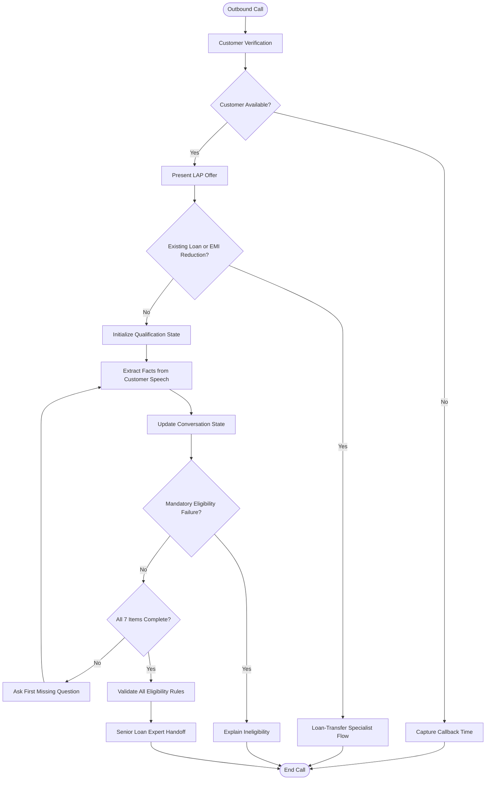

# 🚀 SalesAgents AI — Home Credit Loan Against Property (LAP) Voice Agent

## 📑 Table of Contents

- [1. Project Overview](#-1-project-overview)
- [2. Problem Statement](#-2-problem-statement)
- [3. Project Objectives](#-3-project-objectives)
- [4. Key Features](#-4-key-features)
- [5. System Architecture](#-5-system-architecture)
- [6. Customer Conversation Flow](#-6-customer-conversation-flow)
- [7. Seven Eligibility Questions](#-7-seven-eligibility-questions)
- [8. Eligibility Decision Rules](#-8-eligibility-decision-rules)
- [9. Conversation State Management](#-9-conversation-state-management)
- [10. Repository Structure](#-10-repository-structure)
- [11. Technology Stack](#-11-technology-stack)
- [12. Installation and Execution](#-12-installation-and-execution)
- [13. Sample Conversation](#-13-sample-conversation)
- [14. Testing Scenarios and Results](#-14-testing-scenarios-and-results)
- [15. Error Handling and Edge Cases](#-15-error-handling-and-edge-cases)
- [16. Responsible AI and Limitations](#-16-responsible-ai-and-limitations)
- [17. Future Enhancements](#-17-future-enhancements)
- [18. Conclusion](#-18-conclusion)

---

## 🎯 1. Project Overview

The **SalesAgents AI — Home Credit LAP Voice Agent** is a conversational AI solution designed to contact existing Home Credit customers, introduce a potential Loan Against Property (LAP) offer, and conduct preliminary eligibility screening through natural voice conversations.

The agent collects seven required eligibility checklist items, understands information provided in different orders, maintains conversation context, applies predefined business rules, and identifies the appropriate next action.

Depending on the customer's responses, the agent can:

- Continue the qualification process.
- Immediately end the standard flow when a mandatory eligibility condition fails.
- Route existing-property-loan or EMI-reduction enquiries to a loan-transfer specialist.
- Capture a preferred callback time when the customer is unavailable.
- Refer customers who satisfy all required preliminary checks to a senior loan expert.

**Core principle:**

> Listen intelligently. Remember context. Apply business rules consistently. Hand off responsibly.

This project demonstrates the practical application of prompt engineering, conversational AI, structured state management, business-rule validation, and scenario-based testing.

## 🔍 2. Problem Statement

Traditional outbound loan qualification can involve repetitive questions, manual data collection, inconsistent screening, and delays in identifying the correct customer journey.

A conventional scripted bot may also struggle when customers interrupt, provide several answers together, correct previous information, or ask questions unrelated to the current eligibility step.

These challenges can result in poor customer experience, repeated questions, inaccurate qualification, and premature handoffs.

### 💡 Proposed Solution

The proposed AI voice agent combines a structured conversation flow with contextual information extraction and explicit eligibility rules.

Instead of treating each customer response as an isolated answer, the agent identifies all relevant facts, updates the qualification state, validates mandatory conditions, and asks only the earliest unanswered checklist question.

This approach aims to improve consistency, reduce unnecessary repetition, and ensure that qualification and handoff decisions follow the defined assignment requirements.

## 🎯 3. Project Objectives

The primary objectives are to:

1. **Automate outbound qualification:** Introduce the LAP offer to existing customers through voice conversations.
2. **Capture seven eligibility items:** Collect all mandatory qualification information without skipping required checks.
3. **Maintain contextual memory:** Recognize and retain information provided out of sequence.
4. **Enforce business rules:** Apply property, documentation, income, loan amount, and tenure criteria consistently.
5. **Handle conversational interruptions:** Respond to relevant questions, clarifications, and diversions before resuming the checklist.
6. **Detect alternate requirements:** Identify existing property loans and EMI-reduction enquiries.
7. **Support callback handling:** Capture the customer's preferred time when they are busy.
8. **Control handoffs:** Refer eligible prospects to a senior loan expert only after all seven items have been answered and all applicable checks have passed.
9. **Validate reliability:** Evaluate the agent through normal, negative, and edge-case test scenarios.

## ✨ 4. Key Features

| Feature | Description |
|---|---|
| 🗣️ Natural Voice Interaction | Uses short, conversational responses instead of rigid yes/no questions. |
| 🧠 Contextual Information Extraction | Captures multiple facts from a single customer utterance. |
| 🔄 Sequential Qualification | Asks the first missing checklist item while preserving the required seven-item process. |
| ⚖️ Rule-Based Validation | Applies explicit eligibility criteria to customer responses. |
| 🚫 Immediate Disqualification | Stops the standard flow when a mandatory condition fails. |
| 🔀 Loan-Transfer Detection | Separates existing-loan and EMI-reduction requests from fresh LAP enquiries. |
| ⏰ Callback Handling | Captures a suitable callback time when the customer is busy. |
| 💬 Diversion Management | Handles questions without inventing unsupported product information. |
| ✍️ Correction Handling | Updates previously captured information when the customer clearly corrects it. |
| 🤝 Human Handoff | Routes preliminarily qualified customers to a senior loan expert. |
| 🧪 Scenario-Based Testing | Covers eligible, ineligible, ambiguous, interrupted, and exceptional conversations. |

## 🏗️ 5. System Architecture

The proposed architecture separates conversational understanding, state tracking, eligibility validation, and final routing.



### Architecture Components

**Conversation Interface:** Manages the greeting, verification, offer presentation, and customer dialogue.

**Language Understanding:** Interprets natural speech, extracts facts, recognizes corrections, and detects customer intent.

**Conversation State:** Tracks which checklist items have been answered, which remain unknown, and which answers require clarification.

**Eligibility Logic:** Validates the captured information against the specified business rules.

**Routing and Handoff:** Determines whether to continue, disqualify, capture a callback, direct an existing-loan case to a specialist, or hand off a qualified prospect.

*The diagram represents the proposed logical design. The actual components depend on the voice-agent platform and implementation used.*

## 🔄 6. Customer Conversation Flow

The agent follows a controlled but flexible conversation journey.

| Stage | Agent Action | Expected Outcome |
|---|---|---|
| 1. Greeting | Introduce the agent and identify the intended customer. | Verification |
| 2. Availability | Determine whether the customer can talk. | Continue or callback |
| 3. Offer Presentation | Explain the potential LAP offer and preliminary screening purpose. | Customer engagement |
| 4. Intent Detection | Check for an existing property loan or EMI-reduction requirement. | Fresh LAP or specialist route |
| 5. Information Capture | Collect all seven checklist items. | Qualification data |
| 6. Eligibility Validation | Apply the specified rules after each relevant answer. | Continue or disqualify |
| 7. Completion Check | Confirm all seven items have been answered. | Complete preliminary assessment |
| 8. Final Routing | Refer a qualifying customer to a senior loan expert. | Human handoff |
| 9. Termination | End the call politely after the appropriate outcome. | Call closed |

**Important:** Existing-loan detection and mandatory disqualification take priority over continuing the ordinary qualification questionnaire.

## 📋 7. Seven Eligibility Questions

The qualification checklist contains seven items. Item 5 combines occupation and income mode.

| No. | Question | Information Required |
|:---:|---|---|
| 1 | What type of property do you own? | Residential, Commercial, Industrial, or Agricultural |
| 2 | Is the property solely owned or jointly owned? | Sole or Joint |
| 3 | Are the original property documents available for verification? | Available or Unavailable |
| 4 | What loan amount are you looking for? | Requested amount in rupees |
| 5 | Are you salaried or self-employed, and is your income received through a bank or in cash? | Occupation and income mode |
| 6 | Approximately what is the current market value of the property? | Estimated market value |
| 7 | What repayment tenure would you prefer? | Desired tenure in years |

### Questioning Strategy

The agent must collect every required item but should not mechanically ask each question in a fixed sequence when the customer has already supplied relevant information.

For example, if a customer states that their property is residential, jointly owned, and worth ₹1 crore, the agent should capture all three facts and continue with the first missing item.

## ⚖️ 8. Eligibility Decision Rules

The following rules define the expected preliminary qualification behavior for this assignment.

| Eligibility Field | Accepted Condition | Failure or Exception |
|---|---|---|
| Property Type | Residential, Commercial, Industrial | Agricultural → Disqualify |
| Ownership | Sole or Joint | Neither ownership type is inherently disqualifying |
| Original Documents | Originals available for verification | Originals unavailable → Disqualify |
| Loan Amount | Up to ₹75 lakh | Above ₹75 lakh → Offer ₹75 lakh alternative |
| Occupation | Salaried or Self-employed | Other occupation categories require clarification against the assignment rules |
| Income Mode | Bank | Cash → Disqualify |
| Property Market Value | Capture customer's estimate | No minimum value threshold specified |
| Tenure | 3–15 years inclusive | Below 3 or above 15 years → Disqualify |

### Loan Amount Above ₹75 Lakh

If the customer requests an amount exceeding ₹75 lakh, the agent must explain the offer limit and ask whether they wish to proceed with ₹75 lakh.

- **Accepts:** Update the requested amount to ₹75 lakh and continue.
- **Declines:** End the qualification flow politely.
- **Unclear response:** Clarify before proceeding.

The agent must not automatically disqualify a customer merely because the initial request exceeds the offer limit.

### Immediate Disqualification

When a confirmed answer violates a mandatory criterion:

1. Stop the normal qualification sequence.
2. Explain politely that the customer does not meet the criteria for this specific offer.
3. Avoid asking additional eligibility questions.
4. End the call.

### Final Handoff Gate

The agent may initiate the senior-expert handoff only when:

- All seven checklist items are answered.
- All mandatory eligibility rules pass.
- No unresolved disqualifying condition remains.
- The enquiry is not an existing-loan or EMI-reduction case requiring a specialist route.

The handoff indicates preliminary qualification, not final loan approval.

## 🧠 9. Conversation State Management

The agent maintains an internal representation of the customer's qualification progress.

Example:

```yaml
customer_verified: UNKNOWN
customer_available: UNKNOWN

property_type: UNKNOWN
ownership_status: UNKNOWN
documents_available: UNKNOWN
loan_amount: UNKNOWN
occupation: UNKNOWN
income_mode: UNKNOWN
market_value: UNKNOWN
tenure: UNKNOWN

existing_property_loan: UNKNOWN
emi_reduction_request: UNKNOWN

disqualified: false
transfer_required: false
callback_time: UNKNOWN
qualification_complete: false
handoff_eligible: false
```

### State Management Algorithm

After every customer utterance:

1. Extract all relevant facts and customer intent.
2. Resolve clear corrections using the latest valid answer.
3. Detect existing-loan or EMI-reduction intent.
4. Validate any mandatory eligibility conditions.
5. Update the stored state.
6. Identify the first unanswered checklist item.
7. Ask only the next required question.
8. If all items are complete, validate the final state and route accordingly.

**Core design principle:**

`EXTRACT → VALIDATE → UPDATE → FIND FIRST MISSING ITEM → RESPOND`

Unknown or ambiguous information must remain unknown until clarified. The agent must not invent missing answers or treat uncertainty as confirmed eligibility.

## 📂 10. Repository Structure

The following is a recommended repository layout. Adapt it to the files that actually exist in your GitHub repository.

```text
salesagents-ai-lap-voice-agent/
│
├── README.md
│
├── prompts/
│   └── system_prompt.md
│
├── documentation/
│   ├── requirements_and_business_rules.md
│   ├── conversation_flow.md
│   └── state_management.md
│
├── tests/
│   ├── test_scenarios.md
│   ├── expected_results.md
│   └── test_results.md
│
├── recordings/
│   └── recording_links.md
│
├── transcripts/
│   └── sample_transcript.md
│
└── submission/
    └── final_submission_checklist.md
```

### Directory Guide

| Directory/File | Purpose |
|---|---|
| `README.md` | Project overview, architecture, rules, and testing summary |
| `prompts/` | Complete system prompt and agent instructions |
| `documentation/` | Requirements, workflow, and design decisions |
| `tests/` | Test cases and expected versus observed behavior |
| `recordings/` | Links to actual call recordings and supporting logs |
| `transcripts/` | Transcripts from completed test calls |
| `submission/` | Final assignment deliverables and review checklist |

## 🛠️ 11. Technology Stack

Use this table to document the actual technologies used in your implementation.

| Component | Technology | Purpose |
|---|---|---|
| Prompt Engineering | System prompt and structured instructions | Define conversational behavior and business rules |
| Voice Agent Platform | Retell AI, Bolna, or the platform actually used | Execute voice conversations |
| Language Model | Actual configured model | Understand responses and extract facts |
| Speech Recognition | Platform-provided or configured STT | Convert customer speech into text |
| Text-to-Speech | Platform-provided or configured TTS | Generate spoken agent responses |
| State Management | Platform state, structured variables, or application code | Maintain qualification progress |
| Eligibility Validation | Prompt logic and/or deterministic application rules | Enforce eligibility conditions |
| Testing | Recorded calls, transcripts, and scenario matrix | Evaluate performance |

Do not list tools, APIs, models, or programming languages as implemented unless you actually used them.

## ⚙️ 12. Installation and Execution

This is a prompt-engineering assignment, so the execution procedure depends on the platform used.

### Platform-Based Implementation

1. Open your selected voice-agent platform.
2. Create or configure the voice agent.
3. Add the completed system prompt from `prompts/system_prompt.md`.
4. Configure the required variables, language, voice, and call settings.
5. Run a controlled test using a permitted test customer or simulation.
6. Review the call recording, transcript, and qualification outcome.
7. Repeat the process for the remaining test scenarios.
8. Record observed results in `tests/test_results.md`.

### Optional Local Documentation Workflow

If the repository contains only Markdown documentation, no Python environment or dependency installation is required to read the files. GitHub will render `README.md` automatically.

If executable code is included, add the actual dependency file and the appropriate installation and execution commands.

## 💬 13. Sample Conversation

The following is an illustrative happy-path conversation.

**Agent:** Hello, may I speak with Rahul?

**Customer:** Yes, this is Rahul.

**Agent:** Thank you, Rahul. I'm calling from Home Credit regarding a potential Loan Against Property offer for our valued customers. The offer is available for up to ₹75 lakh, subject to eligibility. May I ask you a few questions to check whether it suits your requirements?

**Customer:** Sure.

**Agent:** What type of property do you own?

**Customer:** It's a residential house, jointly owned with my wife, and worth around ₹1 crore.

**Agent:** Thank you. I've noted that it's a residential property, jointly owned, with an estimated market value of ₹1 crore. Are the original property documents available for verification?

**Customer:** Yes, the originals are available.

**Agent:** Great. What loan amount are you looking for?

**Customer:** Around ₹50 lakh.

**Agent:** Are you salaried or self-employed, and is your income received through a bank or in cash?

**Customer:** I'm salaried, and my salary comes into my bank account.

**Agent:** What repayment tenure would you prefer?

**Customer:** Ten years.

**Agent:** Thank you for sharing those details. Your responses meet the preliminary criteria for this offer. A senior loan expert will contact you to discuss the next steps and the applicable interest rate.

**Expected result:** All seven checklist items are captured, all specified criteria pass, and the customer is referred for a senior-expert discussion.

*This example is illustrative and does not represent an actual call or guarantee loan approval.*

## 🧪 14. Testing Scenarios and Results

The project should be evaluated using both standard and adversarial conversations.

| Test ID | Scenario | Expected Behavior |
|---|---|---|
| T01 | Fully eligible customer | Complete checklist and hand off |
| T02 | Agricultural property | Immediate disqualification |
| T03 | Cash-based income | Immediate disqualification |
| T04 | Original documents unavailable | Immediate disqualification |
| T05 | Tenure below 3 years | Disqualification |
| T06 | Tenure above 15 years | Disqualification |
| T07 | Loan request above ₹75 lakh | Offer the ₹75 lakh alternative |
| T08 | Joint ownership | Continue |
| T09 | Existing property loan | Specialist route and end standard flow |
| T10 | EMI-reduction requirement | Specialist route and end standard flow |
| T11 | Out-of-order answers | Capture all provided facts |
| T12 | Customer is busy | Capture callback preference and end |
| T13 | Contradictory answers | Apply the latest clear correction |
| T14 | Ambiguous documentation | Ask for clarification |
| T15 | Interest-rate question | Avoid inventing rates |
| T16 | Customer interrupts | Respond briefly and resume |
| T17 | Customer declines ₹75 lakh | End qualification |
| T18 | All eligibility checks complete | Handoff only after final validation |

### Test Results Template

| Test ID | Expected Result | Actual Result | Status | Notes |
|---|---|---|---|---|
| T01 | Complete qualification and handoff | Pending execution | Not run | Record after testing |
| T02 | Immediate disqualification | Pending execution | Not run | Record after testing |
| T03 | Immediate disqualification | Pending execution | Not run | Record after testing |
| T09 | Specialist route | Pending execution | Not run | Record after testing |
| T11 | Capture out-of-order answers | Pending execution | Not run | Record after testing |

**Testing integrity:** Replace the pending entries with observed outcomes from actual test calls. Report pass/fail results only after reviewing the corresponding transcripts or call logs.

## 🛡️ 15. Error Handling and Edge Cases

The agent must be robust to natural conversational variation.

### Out-of-Order Responses

Capture every relevant fact from the response and continue with the first missing checklist item.

### Corrections

If the customer changes a previous answer, update the state using the latest clear correction and revalidate the applicable rules.

### Ambiguous Answers

Ask a focused clarification rather than assuming the answer is eligible.

### Interruptions

Respond briefly to the customer's immediate question and resume the qualification process without losing the current state.

### Unavailable Product Information

Use only verified information available in the configured product context. If the exact interest rate or another product detail is unavailable, explain that a senior loan expert will clarify it.

### Call or API Failure

Where supported by the platform, handle failed calls, timeouts, and unavailable services gracefully. Avoid reporting a successful handoff unless the platform confirms it.

### Incomplete Conversations

If a call ends before all required checklist items are captured, record the qualification as incomplete rather than treating the customer as qualified.

## 🔐 16. Responsible AI and Limitations

### Responsible AI Principles

- Clearly identify the caller and the purpose of the conversation.
- Use approved customer-contact practices and respect applicable consent and opt-out requirements.
- Protect customer information and restrict access to recordings and transcripts.
- Avoid unnecessary collection of personal or financial information.
- Never guarantee loan approval or disbursal.
- Never invent interest rates, fees, or eligibility criteria.
- Keep responses concise, respectful, and easy to understand.
- Route unresolved or specialist-specific questions to an appropriate human expert.

### Limitations

- Eligibility outcomes depend on the accuracy of customer responses and the supplied business rules.
- Voice recognition may misinterpret amounts, property types, or tenure.
- A prompt alone cannot guarantee deterministic enforcement in every interaction.
- Final lending decisions may require additional verification and formal underwriting.
- The agent cannot provide unsupported product details that are absent from its approved knowledge source.
- Call recordings and transcripts require appropriate handling, access controls, and retention practices.

## 🚀 17. Future Enhancements

Potential improvements include:

- **Multilingual Support:** Support additional configured languages and natural language switching where permitted.
- **CRM Integration:** Save qualification outcomes and customer follow-up requirements in an approved CRM.
- **Analytics Dashboard:** Track qualification rates, disqualification reasons, call completion, and handoff outcomes.
- **Improved Speech Recognition:** Improve recognition of Indian accents, financial amounts, and code-switched speech.
- **Automated Regression Testing:** Run repeatable test suites whenever the system prompt or eligibility logic changes.
- **Structured Rule Engine:** Separate business-rule enforcement from free-form language generation.
- **Monitoring and Observability:** Track tool failures, incomplete calls, incorrect classifications, and handoff errors.
- **Human Feedback Loop:** Use reviewed transcripts to identify weaknesses and improve prompt reliability.

## 🏁 18. Conclusion

The SalesAgents AI LAP Voice Agent project demonstrates how prompt engineering can be applied to a practical financial-services use case.

The solution is designed to combine natural voice interaction, contextual memory, sequential information capture, explicit eligibility rules, exception handling, and controlled human handoff.

The central engineering principle is to **extract customer information first, validate mandatory conditions, update the qualification state, and then ask the next missing question**.

By pairing a structured system prompt with clear business rules and evidence-based testing, the project aims to demonstrate reliable, explainable, and customer-friendly preliminary loan qualification.

---

<p align="center">

  **SalesAgents AI × Home Credit LAP**

  *Designed with structured thinking. Built for conversational intelligence. Evaluated through testing.*

</p>
